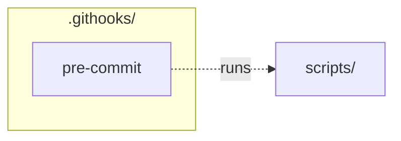

# `.githooks/`

> Local git hooks: before each commit — every function documented, READMEs regenerated, quick tests pass.

[← Project README](../README.md)

## How it connects

Solid `A --> B` = B imports A (A feeds B). Dotted = A runs B. Other directories are collapsed to one box.

## Files

| File | What it does |
|---|---|
| [`pre-commit`](pre-commit) | Pre-submit checks: every function documented, READMEs regenerated and staged, quick tests pass. |

## Notes

<!-- BEGIN MANUAL -->
<!-- END MANUAL -->

<!-- Generated by scripts/update_readmes.py — edit docstrings, not this file. -->
