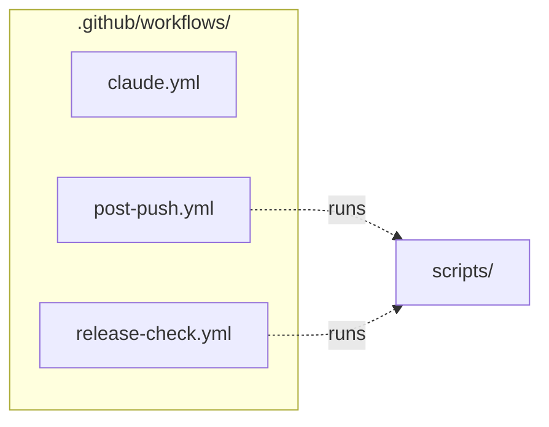

# `.github/workflows/`

> GitHub Actions: tests + docstring rule + READMEs + work log on every push; Claude fixes @claude issues.

[← Project README](../../README.md)

## How it connects

Solid `A --> B` = B imports A (A feeds B). Dotted = A runs B. Other directories are collapsed to one box.

## Files

| File | What it does |
|---|---|
| [`claude.yml`](claude.yml) | Claude — Claude fixes code when an issue/comment mentions @claude or an issue gets the notebook-error label. |
| [`post-push.yml`](post-push.yml) | post-push — On every push/PR: docstring rule + tests; on push: refresh READMEs; on main: append an English work-log entry. |
| [`release-check.yml`](release-check.yml) | release-check — Every run's GitHub release must be complete: checked when a run's tag is pushed, daily, and on demand. |

## Notes

<!-- BEGIN MANUAL -->
<!-- END MANUAL -->

<!-- Generated by scripts/update_readmes.py — edit docstrings, not this file. -->
