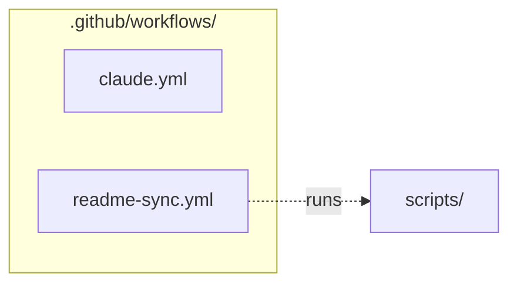

# `.github/workflows/`

> GitHub Actions: keep READMEs in sync on push; Claude fixes code for @claude / notebook-error issues.

[← Project README](../../README.md)

## How it connects

Solid `A --> B` = B imports A (A feeds B). Dotted = A runs B. Other directories are collapsed to one box.

## Files

| File | What it does |
|---|---|
| [`claude.yml`](claude.yml) | Claude — Claude fixes code when an issue/comment mentions @claude or an issue gets the notebook-error label. |
| [`readme-sync.yml`](readme-sync.yml) | readme-sync — On every push, rebuild all README.md files from the code and commit them back if they changed. |

## Notes

<!-- BEGIN MANUAL -->
<!-- END MANUAL -->

<!-- Generated by scripts/update_readmes.py — edit docstrings, not this file. -->
