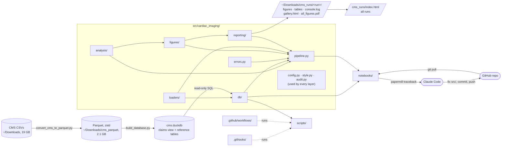

# Cardiac Imaging Utilization in Medicare FFS (2018–2023)

> State and national trends in Echo, SPECT, cardiac CTA, MRI and PET among Medicare fee-for-service beneficiaries, plus negative binomial models of CTA use vs imaging-physician density. Produces Figures 1–9, S1–S2 and Table 1.

## How it all connects

Solid `A --> B` = B uses A. Dotted = A runs B. Each directory has its own README (table below).



## Quick start

```bash
source ~/jupyter-env/bin/activate && pip install -e ".[notebook]"
```
```bash
python scripts/convert_cms_to_parquet.py
```
```bash
python scripts/build_database.py
```
```bash
python -m cardiac_imaging.pipeline
```

Each run gets its own folder in `~/Downloads/cms_runs/` (linked as `runs/` here): figures (PNG + TIFF), result tables (CSV), `console.log`, `manifest.json`, a `gallery.html` of every chart and `all_figures.pdf`. `runs/index.html` lists every run with its headline IRRs. Use `--no-tiff` for quick runs, `--label` to tag one.

Paths default to `~/Downloads`; override with the variables in [`.env.example`](.env.example). Full setup and the Claude debug loop: [`docs/SETUP_PLAN.md`](docs/SETUP_PLAN.md).

## Directory map

| Directory | What it is |
|---|---|
| [`src/cardiac_imaging/`](src/cardiac_imaging/README.md) | Cardiac imaging utilization in Medicare FFS, 2018–2023: data, models, figures. |
| [`src/cardiac_imaging/analysis/`](src/cardiac_imaging/analysis/README.md) | Analysis: utilization rates, market share, Table 1, and negative binomial density models. |
| [`src/cardiac_imaging/db/`](src/cardiac_imaging/db/README.md) | Database layer: open the local DuckDB file (read-only for analysis) and build its tables from Parquet + reference files. |
| [`src/cardiac_imaging/figures/`](src/cardiac_imaging/figures/README.md) | Figures: every publication figure (1–9, S1–S2, state panel) plus PNG/TIFF export helpers. |
| [`src/cardiac_imaging/loaders/`](src/cardiac_imaging/loaders/README.md) | Loaders: pull analysis-ready DataFrames out of the database (claims, enrollment, demographics, providers). |
| [`src/cardiac_imaging/reporting/`](src/cardiac_imaging/reporting/README.md) | Reporting: one folder per run (figures, tables, log, manifest), a chart gallery + PDF per run, and an index of all runs. |
| [`scripts/`](scripts/README.md) | Command-line tools: CSV → Parquet conversion, database build, README generation, git hook install. |
| [`notebooks/`](notebooks/README.md) | Thin Jupyter driver: imports from src/, runs the pipeline. Run headless with papermill. |
| [`.github/workflows/`](.github/workflows/README.md) | GitHub Actions: keep READMEs in sync on push; Claude fixes code for @claude / notebook-error issues. |
| [`.githooks/`](.githooks/README.md) | Local git hooks: regenerate READMEs before each commit. |
| [`legacy/`](legacy/README.md) | The original single-file analysis script, kept unchanged for reference. Not imported by anything. |

## How errors reach Claude

1. Claude Code runs `papermill notebooks/main.ipynb runs/out.ipynb`; a failing step writes `logs/last_error.md`.
2. Claude reads the traceback, fixes `src/` (never the notebook JSON), reruns until it passes.
3. Claude runs `python scripts/update_readmes.py` and commits code + READMEs together, then pushes.
4. Optional: with `CARDIAC_GITHUB_TOKEN` set, a failure also opens a `notebook-error` issue that the Claude GitHub Action answers with a fix PR.

## READMEs are generated

Every `README.md` is rebuilt from docstrings and imports by [`scripts/update_readmes.py`](scripts/update_readmes.py) — on every commit (git hook) and every push (GitHub Action). To change a description, edit the module docstring, not the README. Free-form notes go inside the MANUAL block below.

## Notes

<!-- BEGIN MANUAL -->
<!-- END MANUAL -->

<!-- Generated by scripts/update_readmes.py — edit docstrings, not this file. -->
