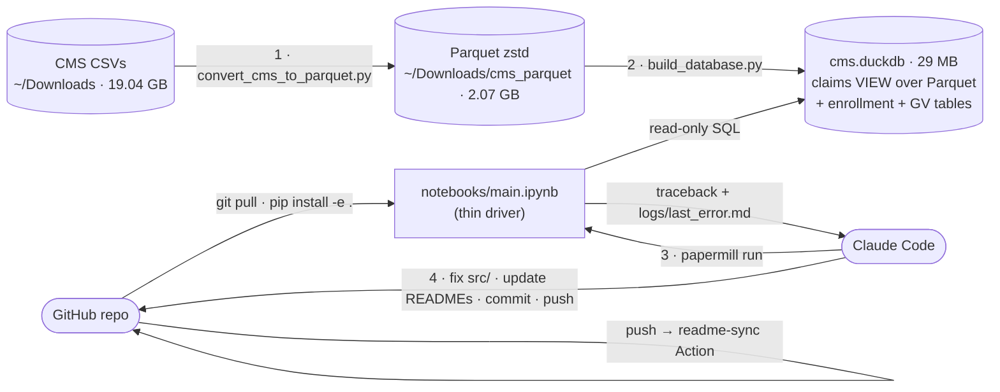

# Setup plan: local DuckDB (Parquet) ⇄ Jupyter ⇄ GitHub ⇄ Claude

Goal: query 19 GB of CMS Part B claims from a Jupyter notebook whose code lives on GitHub.
Claude Code runs the notebook headless, reads tracebacks, fixes `src/`, and pushes. READMEs
regenerate themselves on every commit and push.



## Decisions

| Need | Choice | Why |
|---|---|---|
| Database | **Local DuckDB** reading **Parquet** | Free with no limits; fastest; the analysis already speaks DuckDB SQL |
| Claims storage | **View** over the 6 Parquet files (`partb_provider_service`) | Same SQL and same results as a native table. A native copy measured **4.16 GB** on a disk with only ~3–8 GB free. Use `build_database.py --materialize` if you want it anyway. |
| Notebook | **JupyterLab in `~/jupyter-env`**, headless via **papermill** | Can reach the local database (Colab can't); gives Claude a reproducible headless run |
| Fixer | **Claude Code** locally (primary); Claude GitHub Action (optional) | Locally, Claude can rerun against real data. The Action can only fix from the traceback. |
| Optional cloud copy | MotherDuck Lite (10 GB free) | Only if co-investigators need shared access: set `CARDIAC_DB=md:<name>` and `MOTHERDUCK_TOKEN` |

## Verified on this Mac (2026-10-23)

- 6 CSVs, 2018–2023. A second identical copy of each sits in `~/Downloads/Data/`; the converter skips those duplicates.
- Parquet total is 2.07 GB (9.2x smaller). CSV and Parquet row counts match for every year, 58,853,705 rows in all.
- `Rndrng_NPI`, `HCPCS_Cd`, `Rndrng_Prvdr_Zip5`, `Rndrng_Prvdr_State_FIPS` and `Rndrng_Prvdr_RUCA` are all VARCHAR.
- The refactored pipeline on the Parquet database reproduces the original script's output: every table, IRR,
  CI, p-value and NPI count is identical.

## Steps

### 1 · Environment (once)
```bash
source ~/jupyter-env/bin/activate
```
```bash
pip install -e ".[notebook]"
```
```bash
sh scripts/install_hooks.sh
```

### 2 · Data (once, then whenever a new year arrives)
```bash
python scripts/convert_cms_to_parquet.py
```
```bash
python scripts/build_database.py
```
The converter skips files already converted (`--force` reconverts them). Its `--duckdb` flag creates a
**native** 4 GB copy, so leave it off unless you want that copy. `build_database.py` makes the view and loads
the enrollment workbooks (`~/Downloads/Data`) and the GV PUF. All paths can be changed in `.env` (see `.env.example`).

### 3 · Run
```bash
papermill notebooks/main.ipynb runs/out.ipynb
```
Or open it in JupyterLab. Figures are written to `outputs/`. Every filter prints a `[filter]` line with counts
before and after, so no rows disappear silently.

### 4 · Connect GitHub ⇄ Claude
- **Local loop (main path):** in Claude Code, say *"run the notebook and fix any errors"*. It follows `CLAUDE.md`:
  papermill → read the traceback → fix `src/` → rerun → `update_readmes.py` → commit → push.
- **GitHub Action (optional):** run `/install-github-app` in a `claude` terminal (adds the API-key secret), then
  `gh label create notebook-error`. Put a fine-grained token (this repo only, Issues: read/write) in `.env` as
  `CARDIAC_GITHUB_TOKEN`. A failed run then opens an issue that tags @claude, and the Action replies with a fix PR.

### 5 · READMEs stay current
- **Commit:** the `.githooks/pre-commit` hook runs `scripts/update_readmes.py` and stages the READMEs.
- **Push:** `.github/workflows/readme-sync.yml` regenerates them and commits any drift.
- READMEs are built from docstrings and imports, including the Mermaid flowcharts. Edit docstrings, not READMEs.
  Hand-written notes go between the `BEGIN MANUAL` and `END MANUAL` markers.

## Open items for you
1. **Disk is ~96–98% full.** macOS is offloading this iCloud-synced Desktop folder, which made reads hang during setup.
   Move the repo out of Desktop (e.g. `~/code/`) and/or free space.
2. The duplicate CSVs in `~/Downloads/Data/` (about 19 GB) could be deleted. **Only with your OK**, since the original script read them from there.
3. AA and AE (Armed Forces) pass the territory filter: 1,628 cardiac rows are in national totals (Figs 1–2) but
   not in the state maps. Keep or exclude? Changing this alters results, so it needs your decision.
4. Mark which analyses were pre-specified and which were post hoc, so the code comments can say so.
