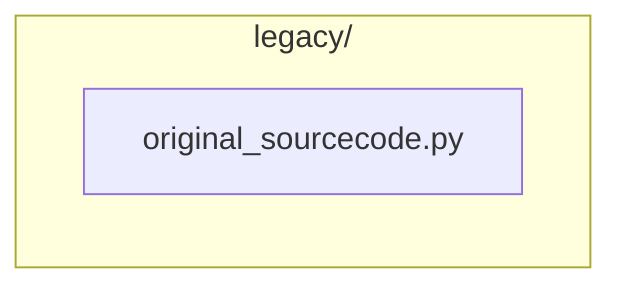

# `legacy/`

> The original single-file analysis script, kept unchanged for reference. Not imported by anything.

[← Project README](../README.md)

## How it connects

Solid `A --> B` = B imports A (A feeds B). Dotted = A runs B. Other directories are collapsed to one box.

## Files

| File | What it does |
|---|---|
| [`original_sourcecode.py`](original_sourcecode.py) | — |

## Notes

<!-- BEGIN MANUAL -->
<!-- END MANUAL -->

<!-- Generated by scripts/update_readmes.py — edit docstrings, not this file. -->
