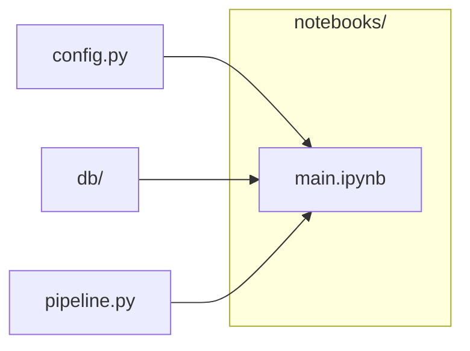

# `notebooks/`

> Thin Jupyter driver: imports from src/, runs the pipeline. Run headless with papermill.

[← Project README](../README.md)

## How it connects

Solid `A --> B` = B imports A (A feeds B). Dotted = A runs B. Other directories are collapsed to one box.

## Files

| File | What it does |
|---|---|
| [`main.ipynb`](main.ipynb) | Cardiac Imaging in Medicare — main driver |

## Notes

<!-- BEGIN MANUAL -->
<!-- END MANUAL -->

<!-- Generated by scripts/update_readmes.py — edit docstrings, not this file. -->
