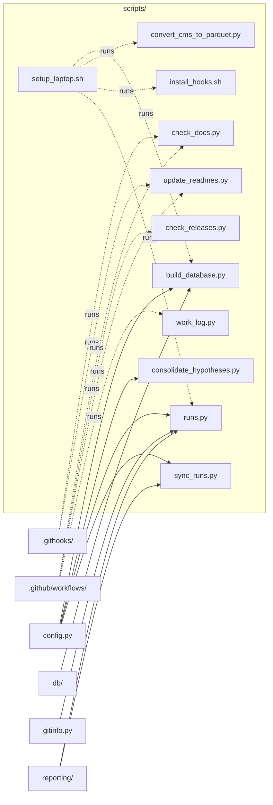

# `scripts/`

> Command-line tools: CSV → Parquet, database build, run history, README/docstring checks, work log, hypotheses.

[← Project README](../README.md)

## How it connects

Solid `A --> B` = B imports A (A feeds B). Dotted = A runs B. Other directories are collapsed to one box.

## Files

| File | What it does |
|---|---|
| [`build_database.py`](build_database.py) | Create cms.duckdb: a claims view over the Parquet files, plus the enrollment and GV reference tables. |
| [`check_docs.py`](check_docs.py) | Fail if any module, function, method or class in src/, scripts/ or tests/ lacks a docstring (READMEs explain every function). |
| [`check_releases.py`](check_releases.py) | Check on GitHub that every run's code-snapshot tag has a complete release (standard library + `gh` only; used in CI). |
| [`consolidate_hypotheses.py`](consolidate_hypotheses.py) | Consolidate project conversations into a log of hypotheses and how they were tested: docs/hypotheses/. |
| [`convert_cms_to_parquet.py`](convert_cms_to_parquet.py) | Convert CMS "Medicare Physician & Other Practitioners - by Provider and Service" |
| [`install_hooks.sh`](install_hooks.sh) | Point git at .githooks/ so READMEs regenerate on every local commit. Run once per clone. |
| [`runs.py`](runs.py) | Manage run history: list local + GitHub runs, publish runs as GitHub Releases, download runs back, rebuild the index. |
| [`setup_laptop.sh`](setup_laptop.sh) | Set up this project on another Mac so you can pick up the research exactly where you left off. |
| [`sync_runs.py`](sync_runs.py) | Sync runs between your laptops through GitHub: upload what's missing, download what's new, repair incomplete releases. |
| [`update_readmes.py`](update_readmes.py) | Regenerate every README.md (root + one per code directory) from the code itself: docstrings, functions, imports. |
| [`work_log.py`](work_log.py) | Write an English summary of pushed work to docs/WORK_LOG.md (run by the post-push GitHub Action on every push to main). |

## Functions

Every function and class in this directory, including internal helpers.

**`build_database.py`**
- `main()` — Parse arguments, build/refresh cms.duckdb tables, and validate them against the data model.

**`check_docs.py`**
- `missing_docstrings(paths)` — ['file:line name', ...] for every module/class/function (incl. methods and private helpers) without a docstring.
- `source_files()` — Every .py file in src/, scripts/ and tests/.
- `main()` — Print missing docstrings and exit 1 if there are any.

**`check_releases.py`**
- `gh_json(path)` — GET a GitHub API path (all pages) via `gh api`, flattened into one list.
- `repo_slug()` — owner/name from GITHUB_REPOSITORY or the git remote.
- `problems_for(tag, release)` — Plain-English problems with one run release ([] = complete).
- `check(slug, only)` — {tag: problems} for every run-* tag (or just `only`).
- `main()` — Check releases (optionally waiting for one) and exit 1 on problems.

**`consolidate_hypotheses.py`**
- `clean(text)` — Strip app/system wrappers, collapse whitespace, redact secrets, cap the length.
- `rid()` — Stable id for a hypothesis record.
- `from_chart_discussions(conv_dir)` — One record per saved chart discussion (the first message is the hypothesis).
- `user_texts(transcript)` — (timestamp, text) for each message the user typed in a Claude Code transcript (tool results and wrappers skipped).
- `from_claude_code(transcript_dir)` — Candidate hypotheses: user messages in this project's Claude Code sessions that propose or question an effect.
- `transcripts_dir()` — ~/.claude/projects/<repo path with / → ->, where Claude Code stores this project's conversations.
- `merge(new, old)` — Keep hand-edited fields (status_override, notes) from the previous hypotheses.json.
- `render(records, n_conv, n_sessions)` — HYPOTHESES.md content.
- `main()` — Collect, merge and write the hypotheses log (or print it with --dry-run).

**`convert_cms_to_parquet.py`**
- `header(csv_path)` — Return the CSV's header row (column names).
- `read_csv_sql(csv_path)` — DuckDB read_csv(...) expression for a CSV, forcing identifier/code columns to VARCHAR.
- `main()` — Find the yearly CSVs, convert each to zstd Parquet, verify row counts, and report sizes.

**`runs.py`**
- `backfill_code(run_dir, sha, note)` — Give a run made before code snapshots existed a best-known code commit (marked approximate).
- `refresh_all()` — Recompute findings, English summary and comparison for every local run (oldest first); sync GitHub notes.
- `main()` — Parse the subcommand (list, publish, fetch, index) and run it.

**`sync_runs.py`**
- `plist_text(minutes)` — LaunchAgent definition that runs this script every `minutes` minutes with the current Python.
- `install_schedule(minutes)` — Write and load the LaunchAgent (replacing an existing one).
- `uninstall_schedule()` — Unload and remove the LaunchAgent if present.
- `main()` — Parse options and sync, check, or manage the schedule.

**`update_readmes.py`**
- `first_line(text)` — First line of a docstring (empty string if none).
- `module_name(path)` — Dotted name for a .py file: cardiac_imaging.loaders.claims, scripts.update_readmes.
- `describe_py(path)` — Parse a .py file: (module purpose, [(signature, doc, private?)...], AST).
- `resolve_imports(tree, mod, is_pkg_init, known)` — Set of known modules that `mod` imports (relative and absolute).
- `describe_other(path)` — One-line purpose for non-Python files.
- `notebook_imports(path, known)` — Known modules imported by a notebook's code cells (magics skipped).
- `scan()` — Files with descriptions, the import graph (edges), and 'runs' references from non-Python files.
- `node_id(label)` — Mermaid-safe node id for a label.
- `group_of(path, focus_dir)` — Node label for `path` when drawing focus_dir: files inside focus_dir stay files, others collapse.
- `collapse(pairs, focus_dir, only_touching)` — Map file-level edges to the boxes drawn for focus_dir, dropping self-edges.
- `mermaid(focus_dir, files, edges, runs)` — Mermaid flowchart for one directory: its files plus collapsed neighbours.
- `rel_link(from_dir, to_path)` — Relative link from one directory to a repo path.
- `files_table(d, files)` — Markdown table of the files in a directory and what each does.
- `api_section(d, files)` — Markdown list of every function in a directory with its one-line explanation.
- `dir_purpose(d, files)` — A directory's one-line purpose (its __init__ docstring or DIR_PURPOSE).
- `code_dirs(files)` — Directories that get a README, in display order.
- `render_dir(d, files, edges, runs)` — README lines for one directory.
- `load_schema()` — Load db/schema.py by file path (standard library only, so the generator needs no installs).
- `column_usage()` — {column name: ['loaders/claims.py: load_detail', ...]} — functions whose source mentions the column.
- `data_model_section()` — README lines describing every table, column meaning and which functions use each column.
- `render_root(files, edges, runs)` — README lines for the repository root (system map, quick start, directory index).
- `with_manual(parts, old_text)` — Append the preserved MANUAL block and the generated-file footer.
- `build()` — {README path: content} for the whole repo.
- `main()` — Regenerate READMEs, or with --check report which are stale.

**`work_log.py`**
- `git()` — Output of a git command in the repo ('' on failure).
- `resolve_range(before, after)` — (base, head) commits; a new branch (all-zero `before`) or missing base falls back to after's parent.
- `area(path)` — Human label for where a file lives.
- `functions_at(commit, path)` — Names of functions/classes (Class.method for methods) in a Python file at `commit`.
- `test_counts(junit)` — (passed, failed, skipped) from a pytest JUnit XML report, or None.
- `bullets(body)` — Commit-body points as single lines: '- ' starts a point; wrapped continuation lines are joined back on.
- `entry(before, after, junit)` — Markdown for one work-log entry.
- `prepend(text, after)` — Insert an entry at the top of WORK_LOG.md unless this head commit is already logged.
- `main()` — Build the entry for --before..--after and prepend it (or print it with --print).

## Notes

<!-- BEGIN MANUAL -->
<!-- END MANUAL -->

<!-- Generated by scripts/update_readmes.py — edit docstrings, not this file. -->
