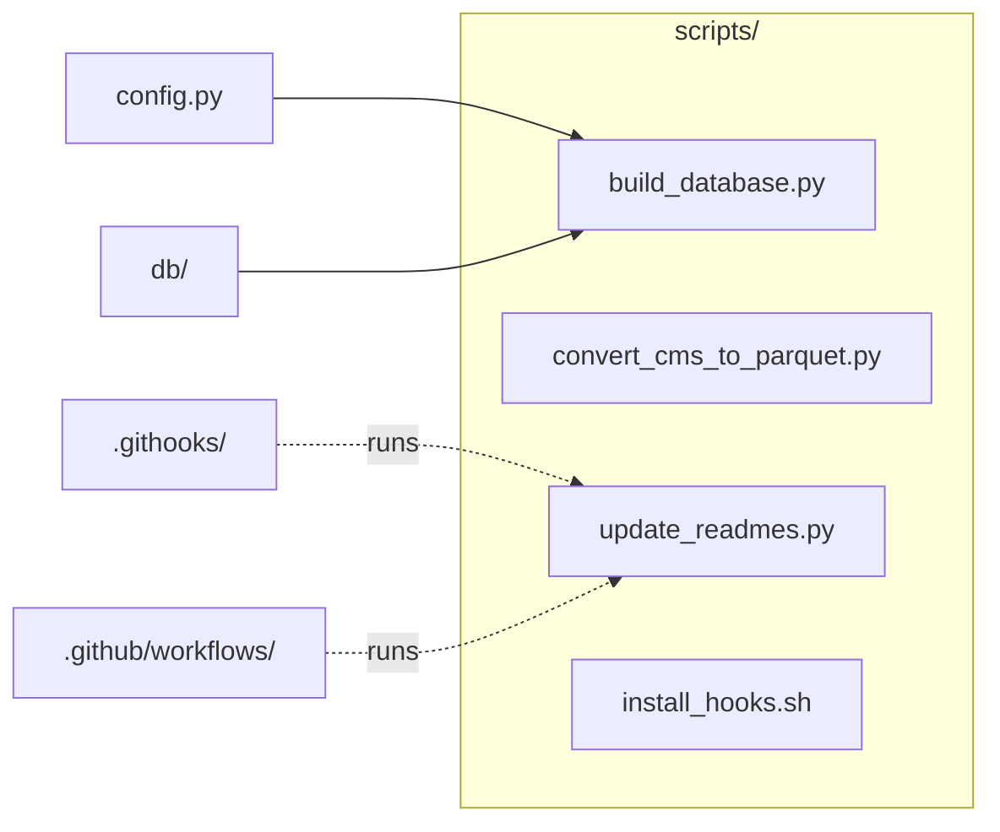

# `scripts/`

> Command-line tools: CSV → Parquet conversion, database build, README generation, git hook install.

[← Project README](../README.md)

## How it connects

Solid `A --> B` = B imports A (A feeds B). Dotted = A runs B. Other directories are collapsed to one box.

## Files

| File | What it does |
|---|---|
| [`build_database.py`](build_database.py) | Create cms.duckdb: a claims view over the Parquet files, plus the enrollment and GV reference tables. |
| [`convert_cms_to_parquet.py`](convert_cms_to_parquet.py) | Convert CMS "Medicare Physician & Other Practitioners - by Provider and Service" |
| [`install_hooks.sh`](install_hooks.sh) | Point git at .githooks/ so READMEs regenerate on every local commit. Run once per clone. |
| [`update_readmes.py`](update_readmes.py) | Regenerate every README.md (root + one per code directory) from the code itself: docstrings, functions, imports. |

## Functions

**`build_database.py`**
- `main()`

**`convert_cms_to_parquet.py`**
- `header(csv_path)`
- `read_csv_sql(csv_path)`
- `main()`

**`update_readmes.py`**
- `first_line(text)`
- `module_name(path)` — Dotted name for a .py file: cardiac_imaging.loaders.claims, scripts.update_readmes.
- `describe_py(path)`
- `resolve_imports(tree, mod, is_pkg_init, known)` — Set of known modules that `mod` imports (relative and absolute).
- `describe_other(path)` — One-line purpose for non-Python files.
- `notebook_imports(path, known)`
- `scan()` — Files with descriptions, the import graph (edges), and 'runs' references from non-Python files.
- `node_id(label)`
- `group_of(path, focus_dir)` — Node label for `path` when drawing focus_dir: files inside focus_dir stay files, others collapse.
- `collapse(pairs, focus_dir, only_touching)`
- `mermaid(focus_dir, files, edges, runs)`
- `rel_link(from_dir, to_path)`
- `files_table(d, files)`
- `api_section(d, files)`
- `dir_purpose(d, files)`
- `code_dirs(files)`
- `render_dir(d, files, edges, runs)`
- `render_root(files, edges, runs)`
- `with_manual(parts, old_text)`
- `build()` — {README path: content} for the whole repo.
- `main()`

## Notes

<!-- BEGIN MANUAL -->
<!-- END MANUAL -->

<!-- Generated by scripts/update_readmes.py — edit docstrings, not this file. -->
