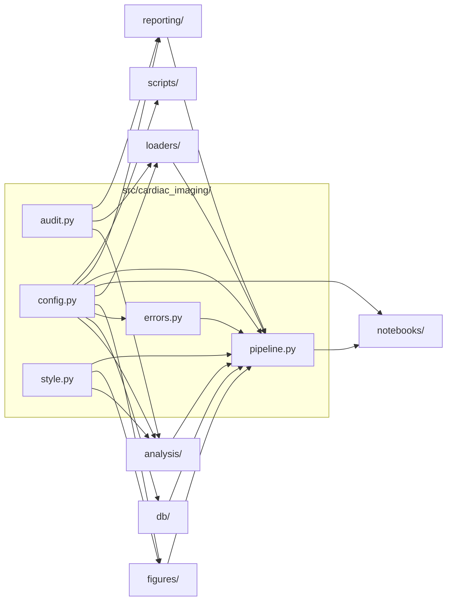

# `src/cardiac_imaging/`

> Cardiac imaging utilization in Medicare FFS, 2018–2023: data, models, figures.

[← Project README](../../README.md)

## How it connects

Solid `A --> B` = B imports A (A feeds B). Dotted = A runs B. Other directories are collapsed to one box.

## Files

| File | What it does |
|---|---|
| [`audit.py`](audit.py) | Integrity log: every filter prints what it kept and dropped, so no rows disappear silently. |
| [`config.py`](config.py) | Single source of truth: paths, table names, population rules, HCPCS codes, enrollment, DPI. |
| [`errors.py`](errors.py) | Capture pipeline failures: write logs/last_error.md and (optionally) open a GitHub issue that tags @claude. |
| [`pipeline.py`](pipeline.py) | End-to-end run: DB → loaders → analysis → figures. Each named step reports its own failure to errors.py. |
| [`style.py`](style.py) | Publication typography (JACC: optimal 12 pt, min 10 pt) and the shared color palette. |

## Functions

**`audit.py`**
- `log_filter(label, before, after, unit, dropped_items)` — Print '[filter] label: before → after unit (n dropped)', record it in FILTER_LOG, and return `after`.

**`errors.py`**
- `format_report(exc, step)`
- `open_issue(title, body)` — Open (or comment on an existing open) issue labeled notebook-error. Needs CARDIAC_GITHUB_TOKEN.
- `report(exc, step)` — Write logs/last_error.md and, unless CARDIAC_REPORT_ERRORS=0, open a GitHub issue.

**`pipeline.py`**
- `step_connect(ctx)`
- `step_load_claims(ctx)`
- `step_figure1(ctx)`
- `step_figure2(ctx)`
- `step_state_maps(ctx)`
- `step_state_table(ctx)`
- `step_density_models(ctx)`
- `step_table1_forest(ctx)`
- `run_all(con, database, report_errors, record, label)` — Run every step in order; on failure, report it (log file + optional GitHub issue) and re-raise.
- `main()`

**`style.py`**
- `apply_rcparams()` — Set matplotlib defaults used by every figure.

## Notes

<!-- BEGIN MANUAL -->
<!-- END MANUAL -->

<!-- Generated by scripts/update_readmes.py — edit docstrings, not this file. -->
