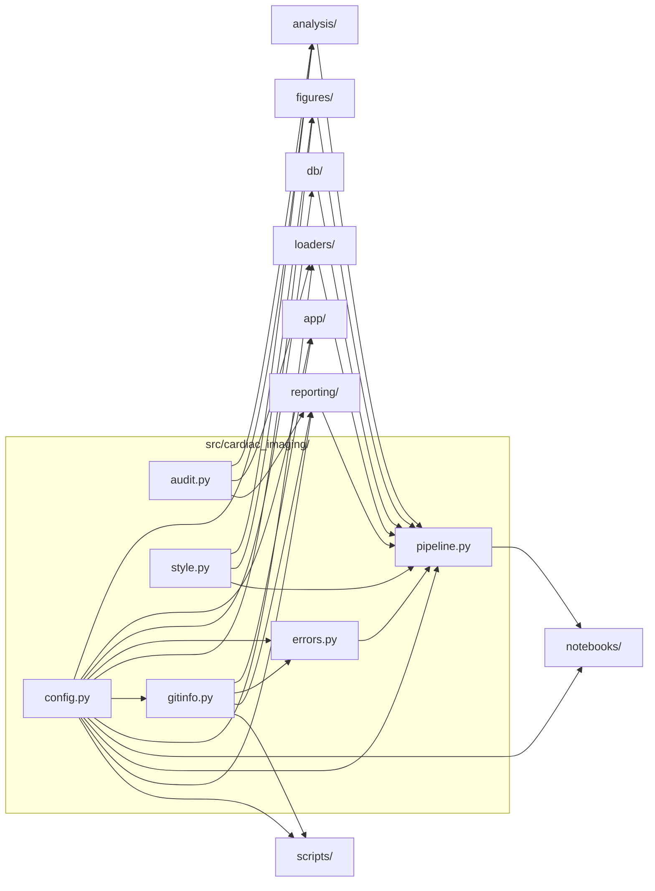

# `src/cardiac_imaging/`

> Cardiac imaging utilization in Medicare FFS, 2018–2023: data, models, figures.

[← Project README](../../README.md)

## How it connects

Solid `A --> B` = B imports A (A feeds B). Dotted = A runs B. Other directories are collapsed to one box.

## Files

| File | What it does |
|---|---|
| [`audit.py`](audit.py) | Integrity log: every filter prints what it kept and dropped, so no rows disappear silently. |
| [`config.py`](config.py) | Single source of truth: paths, table names, population rules, HCPCS codes, enrollment, DPI. |
| [`errors.py`](errors.py) | Capture pipeline failures: write logs/last_error.md and (optionally) open a GitHub issue that tags @claude. |
| [`gitinfo.py`](gitinfo.py) | Git helpers: run git, find the GitHub repo, and freeze the exact working tree as a code-snapshot commit + tag. |
| [`pipeline.py`](pipeline.py) | End-to-end run: DB → loaders → analysis → figures. Each named step reports its own failure to errors.py. |
| [`style.py`](style.py) | Publication typography (JACC: optimal 12 pt, min 10 pt) and the shared color palette. |

## Functions

Every function and class in this directory, including internal helpers.

**`audit.py`**
- `log_filter(label, before, after, unit, dropped_items)` — Print '[filter] label: before → after unit (n dropped)', record it in FILTER_LOG, and return `after`.

**`config.py`**
- `load_dotenv(path)` — Read KEY=VALUE lines from the repo's .env into os.environ (never overriding variables already set).
- `_path(env_var, default)` *(internal)* — Env-var path, resolved against the repo root when relative.

**`errors.py`**
- `format_report(exc, step)` — Markdown error report: failing step, exception, commit, time, Python version and traceback.
- `_github(method, url, token, payload)` *(internal)* — Call the GitHub REST API with a token and return the decoded JSON.
- `open_issue(title, body)` — Open (or comment on an existing open) issue labeled notebook-error. Needs CARDIAC_GITHUB_TOKEN.
- `report(exc, step)` — Write logs/last_error.md and, unless CARDIAC_REPORT_ERRORS=0, open a GitHub issue.

**`gitinfo.py`**
- `git()` — Output of `git <args>` in the repo ('' on failure unless check=True).
- `repo_slug()` — owner/name from GITHUB_REPOSITORY or the origin remote URL (None if not on GitHub).
- `commit_info(sha)` — Subject, author and ISO date of a commit.
- `snapshot_commit(message)` — Commit holding the exact working tree (tracked + untracked, .gitignore respected), without touching
- `ensure_tag(tag, sha, message)` — Create annotated tag `tag` → sha if it doesn't exist (keeps the snapshot commit from being garbage-collected).

**`pipeline.py`**
- `step_connect(ctx)` — Open the read-only database, check required tables, and record claim rows per year.
- `step_load_claims(ctx)` — Verify specialty strings, load cardiac claim detail, and build segment aggregates + national trend.
- `step_figure1(ctx)` — Figure 1 and the 2018 → 2023 change summary.
- `step_figure2(ctx)` — Figure 2 and the national market share table.
- `step_state_maps(ctx)` — State rates for 2018 and 2023, Figures 3–7 and the all-modality panel.
- `step_state_table(ctx)` — Print and save the 2023 state rate table.
- `step_density_models(ctx)` — Fit the CTA density NB models (all, radiology, cardiology); Figures 8, S1, S2; headline IRRs.
- `step_table1_forest(ctx)` — Table 1 (specialty shares by modality) and the Figure 9 forest plot.
- `run_all(con, database, report_errors, record, label)` — Run every step in order; on failure, report it (log file + optional GitHub issue) and re-raise.
- `main()` — Command-line entry point: parse options and run the pipeline.

**`style.py`**
- `apply_rcparams()` — Set matplotlib defaults used by every figure.

## Notes

<!-- BEGIN MANUAL -->
<!-- END MANUAL -->

<!-- Generated by scripts/update_readmes.py — edit docstrings, not this file. -->
