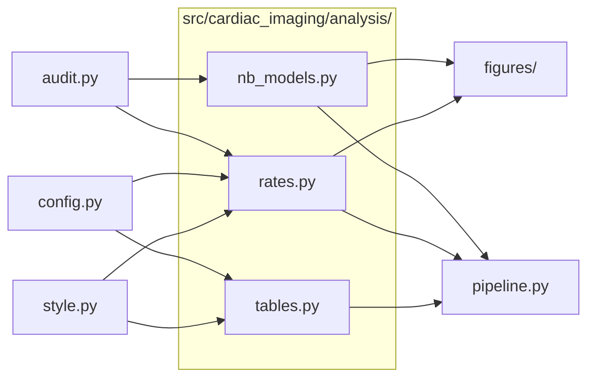

# `src/cardiac_imaging/analysis/`

> Analysis: utilization rates, market share, Table 1, and negative binomial density models.

[← Project README](../../../README.md)

## How it connects

Solid `A --> B` = B imports A (A feeds B). Dotted = A runs B. Other directories are collapsed to one box.

## Files

| File | What it does |
|---|---|
| [`nb_models.py`](nb_models.py) | Multivariable negative binomial (NB2) models of state CTA counts vs physician density, adjusted for age and sex. |
| [`rates.py`](rates.py) | Utilization rates per 1,000 FFS beneficiaries: national decomposition, market share, state rates and deltas. |
| [`tables.py`](tables.py) | Table 1: provider specialty distribution by modality — also the source of the forest-plot share labels. |

## Functions

Every function and class in this directory, including internal helpers.

**`nb_models.py`**
- `fit_nb_design(X, counts, offset)` — Fit NB2 with Poisson start values; returns (result, alpha, Poisson dispersion).
- `irr_at(res, idx)` — (IRR, CI low, CI high, p) for coefficient idx.
- `density_partial_curve(res, x_grid, ncoef, per)` — Predicted rate per `per` beneficiaries across x_grid, other covariates at their mean (0 when z-scored).
- `vif_table(Xz_df)` — Variance inflation factor for each (z-scored) covariate; > 5 signals collinearity.
- `fit_density_models(df, density_col, density_label)` — Fit unadjusted and age/sex-adjusted NB2 models for one density measure.
- `print_model_report(fit, title, n_physicians, year)` — Console table of adjusted-model IRRs plus unadjusted vs adjusted density IRR.
- `results_table(results, names)` — One row per density model: states, physicians, unadjusted and adjusted IRR with 95% CI and p.

**`rates.py`**
- `decompose(trend)` — Add national FFS enrollment and rate per 1,000 to the year × modality trend (Figure 1 data).
- `change_summary(decomp_df, y0, y1, procs)` — % change in volume, national FFS enrollment and rate between y0 and y1, one row per modality (or `procs`).
- `print_change_summary(decomp_df, y0, y1)` — Print volume / enrollment / rate % change between y0 and y1 for each modality.
- `market_share_by_segment(df_agg)` — {segment: year × modality % share} for the four rural/urban × office/facility segments (Figure 2 data).
- `national_market_share(trend)` — Year × modality % share nationally, plus Traditional and Advanced totals.
- `compute_state_rates(df_detail_sub, state_ffs_lookup)` — State × modality services and rate per 1,000 FFS beneficiaries.
- `rate_deltas(rates_end, rates_base, missing_as_zero)` — Outer-join end-year and base-year state rates; rate_delta = end − base.
- `state_summary_table(state_rates)` — State × modality rate table with an 'All Cardiac' total, sorted descending.

**`tables.py`**
- `specialty_distribution(con, year)` — Cardiology / Radiology / Other % of services and total volume, per modality.
- `cta_shares(table1)` — (radiology %, cardiology %) of CTA interpretations, straight from Table 1's CTA row.

## Notes

<!-- BEGIN MANUAL -->
<!-- END MANUAL -->

<!-- Generated by scripts/update_readmes.py — edit docstrings, not this file. -->
