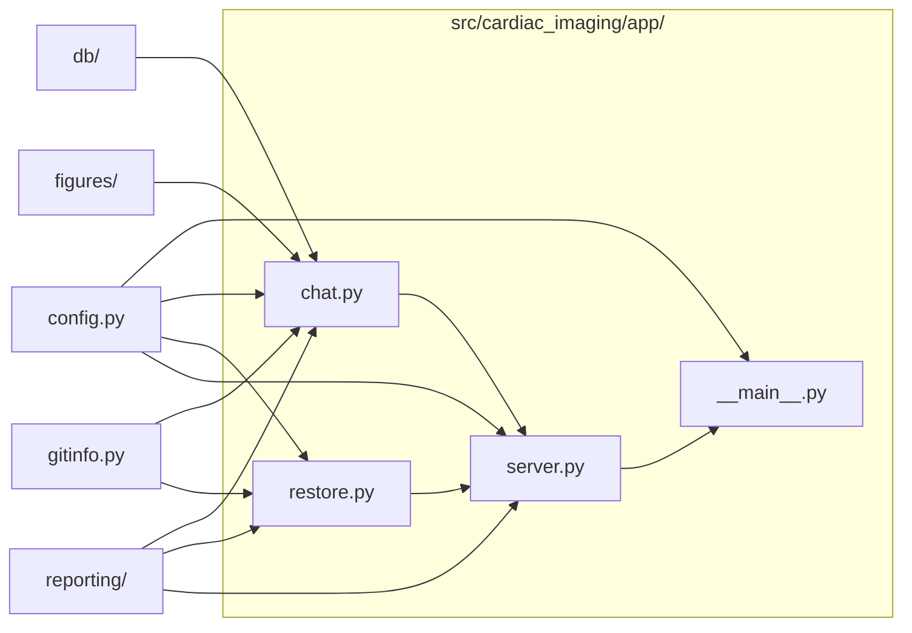

# `src/cardiac_imaging/app/`

> Local app (python -m cardiac_imaging.app): serves the run history with one-click restore/undo and chart discussions.

[← Project README](../../../README.md)

## How it connects

Solid `A --> B` = B imports A (A feeds B). Dotted = A runs B. Other directories are collapsed to one box.

## Files

| File | What it does |
|---|---|
| [`__main__.py`](__main__.py) | Start the local app: python -m cardiac_imaging.app [--port 8765] [--no-browser]. |
| [`chat.py`](chat.py) | Discuss a chart with Claude: builds context from the code that drew it (at the run's snapshot), its tables and data model. |
| [`restore.py`](restore.py) | Restore the code to a run's snapshot (or undo that) as a new commit, after backing up the current state as a tag. |
| [`server.py`](server.py) | Local web server: serves RUNS_DIR (index + galleries) and a small JSON API for restore/undo/push and chart chats. |

## Functions

Every function and class in this directory, including internal helpers.

**`__main__.py`**
- `main()` — Serve the run history on localhost and (optionally) open it in the browser.

**`chat.py`**
- `chart(stem)` — Catalog entry for a chart stem (raises KeyError for unknown charts).
- `_file_at(rel_path, commit)` *(internal)* — Text of a repo file at `commit`; falls back to the working tree, then to the installed package's copy.
- `function_source(ref, commit)` — ('src/cardiac_imaging/x.py', 'def f(...): ...') for 'module:function' at `commit`; empty source if not found.
- `data_model_text()` — Compact text description of the tables and the columns the analysis uses.
- `context(run_id, stem)` — Everything Claude needs about one chart in one run: metadata, generating code, tables, data model, run summary.
- `context_text(ctx)` — The context as one text block (system prompt for the API, appended prompt for Claude Code, or copyable prompt).
- `_path(conv_id)` *(internal)* — File holding one conversation.
- `load(conv_id)` — A saved conversation.
- `save(conv)` — Write a conversation to CONVERSATIONS_DIR.
- `new_conversation(run_id, stem)` — Start an empty conversation about one chart.
- `list_conversations(run_id, stem)` — Saved conversations (newest first), optionally for one run and/or chart.
- `set_outcome(conv_id, outcome, note)` — Record what the discussion concluded about the hypothesis (open / supported / not_supported / inconclusive).
- `_run_cli(cmd)` *(internal)* — Run the Claude Code CLI from the repo root (separate function so tests can replace it).
- `class ClaudeCodeBackend` — Claude Code CLI in print mode, read-only tools, resuming the same session each turn (uses your Claude login).
- `ClaudeCodeBackend.available()` — True when the Claude Code CLI is installed.
- `ClaudeCodeBackend.reply(conv, message, ctx)` — Send `message` and return Claude's answer; stores the session id on `conv`.
- `class AnthropicBackend` — Anthropic Messages API (needs the `anthropic` package and an API key or `ant auth login` profile).
- `AnthropicBackend.available()` — True when the SDK is installed and credentials look configured.
- `AnthropicBackend.reply(conv, message, ctx)` — Send `message` (with the chart image on the first turn) and return the text answer.
- `class HandoffBackend` — No model available: return a ready-made prompt to paste into Claude Code.
- `HandoffBackend.available()` — Always available.
- `HandoffBackend.reply(conv, message, ctx)` — Explain how to enable live chat and return the full prompt to copy.
- `backend()` — The configured backend, or with CHAT_BACKEND=auto the first available of claude-code → api → handoff.
- `send(run_id, stem, message, conv_id, engine)` — Add a user message to a (new or existing) conversation about a chart, get Claude's reply, save, return the conversation.

**`restore.py`**
- `class RestoreError` — A restore could not be done safely; the message says why in plain English.
- `_ensure_local_tag(tag)` *(internal)* — Make sure `tag` exists locally, fetching it from GitHub if needed.
- `status()` — Current branch, commit and whether there are uncommitted changes.
- `restore_to(ref, message)` — Make the code on the current branch identical to `ref` with one new commit; returns what happened.
- `restore_run(run_id)` — Restore the code used by `run_id` (its run-<id> snapshot tag).
- `undo(backup_tag)` — Bring back the code saved in `backup_tag` (undoes a restore).
- `push()` — Push the current branch to GitHub; returns a plain-English result.

**`server.py`**
- `class Handler` — Static files from RUNS_DIR plus /api/* endpoints (POSTs need the session token).
- `Handler.log_message(fmt)` — Quiet access log (errors still surface through responses).
- `Handler.end_headers()` — Never let the browser cache API answers or regenerated pages.
- `Handler._host_ok()` *(internal)* — Reject requests whose Host isn't this machine (blocks DNS-rebinding attacks).
- `Handler._json(status, payload)` *(internal)* — Send a JSON response.
- `Handler._body()` *(internal)* — Parsed JSON request body ({} if empty).
- `Handler.do_GET()` — Static files, or a GET API route.
- `Handler.do_POST()` — Mutating API routes; require the session token in X-App-Token.
- `_try_rebuild_index()` *(internal)* — Refresh index.html so runs finished since the server started appear (best effort).
- `make_server(port, host)` — A ready-to-serve server bound to localhost (port 0 picks a free port).

## Notes

<!-- BEGIN MANUAL -->
<!-- END MANUAL -->

<!-- Generated by scripts/update_readmes.py — edit docstrings, not this file. -->
