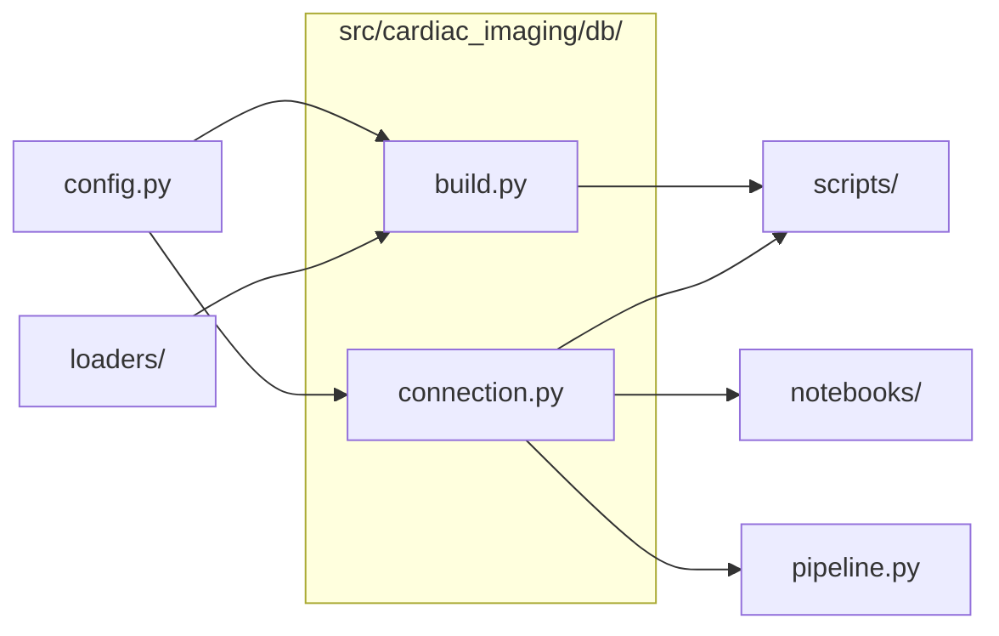

# `src/cardiac_imaging/db/`

> Database layer: open the local DuckDB file (read-only for analysis) and build its tables from Parquet + reference files.

[← Project README](../../../README.md)

## How it connects

Solid `A --> B` = B imports A (A feeds B). Dotted = A runs B. Other directories are collapsed to one box.

## Files

| File | What it does |
|---|---|
| [`build.py`](build.py) | Build the database tables: claims from the yearly Parquet files, plus enrollment and GV reference tables. |
| [`connection.py`](connection.py) | Open the analysis database: local DuckDB file by default (read-only), or MotherDuck when CARDIAC_DB starts with md:. |

## Functions

**`build.py`**
- `build_claims_table(con, parquet_dir, materialize)` — (Re)create CLAIMS_TABLE over YYYY__*.parquet with `year` from the file name; prints rows per year.
- `report_claims(con)` — Rows per year and the types of the identifier columns (must be VARCHAR).
- `load_state_enrollment(con, xlsx_2018, xlsx_2023)` — Parse the CMS state enrollment workbooks and store one clean (year, state, ffs) table.
- `load_gv_puf(con, csv_glob)` — Load the Geographic Variation PUF as all-VARCHAR (cleaning happens in loaders.demographics).

**`connection.py`**
- `get_connection(database, read_only)` — Return a DuckDB connection to `database` (default config.DATABASE). Analysis connections are read-only.
- `require_tables(con, tables)` — Fail fast with a clear message if a build step has not been run.

## Notes

<!-- BEGIN MANUAL -->
<!-- END MANUAL -->

<!-- Generated by scripts/update_readmes.py — edit docstrings, not this file. -->
