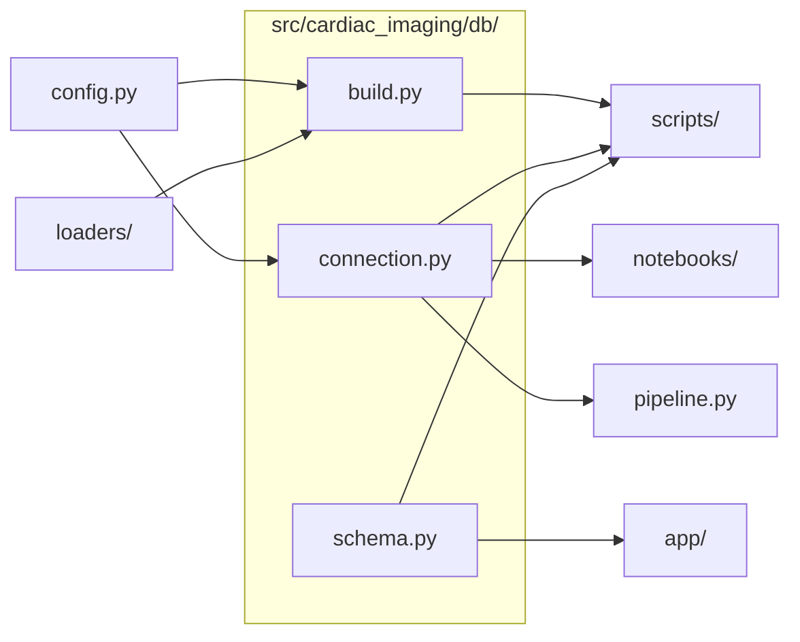
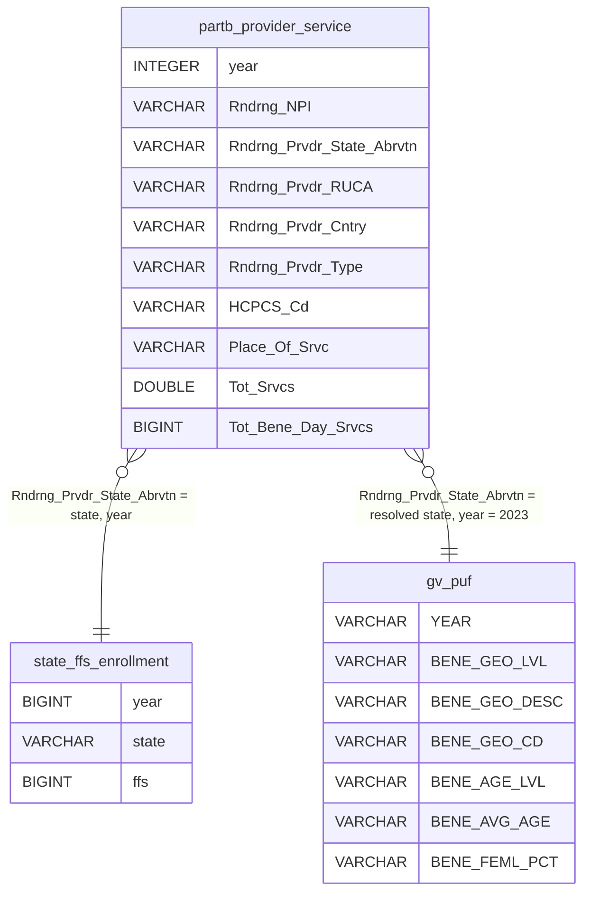

# `src/cardiac_imaging/db/`

> Database layer: open the local DuckDB file (read-only for analysis) and build its tables from Parquet + reference files.

[← Project README](../../../README.md)

## How it connects

Solid `A --> B` = B imports A (A feeds B). Dotted = A runs B. Other directories are collapsed to one box.

## Files

| File | What it does |
|---|---|
| [`build.py`](build.py) | Build the database tables: claims from the yearly Parquet files, plus enrollment and GV reference tables. |
| [`connection.py`](connection.py) | Open the analysis database: local DuckDB file by default (read-only), or MotherDuck when CARDIAC_DB starts with md:. |
| [`schema.py`](schema.py) | Data model: every table in cms.duckdb, what each column means, and which columns the analysis uses (standard library only). |

## Data model

Defined in [`schema.py`](schema.py) — the build script and the tests check the real database against it. The diagram shows only the columns the analysis uses.

**Joins**

- `partb_provider_service` → `state_ffs_enrollment` on `Rndrng_Prvdr_State_Abrvtn = state, year`: Services per state divided by FFS enrollees → rate per 1,000 beneficiaries (Figures 1, 3–8).
- `partb_provider_service` → `gv_puf` on `Rndrng_Prvdr_State_Abrvtn = resolved state, year = 2023`: State mean age and % female join the CTA density models as covariates (Figures 8, 9, S1, S2).

### `partb_provider_service` (view)

- **One row =** One row per provider (NPI) × HCPCS code × place of service × year.
- **Source:** CMS Medicare Physician & Other Practitioners — by Provider and Service, 2018–2023 (public use file).
- **Built by:** scripts/build_database.py → db.build.build_claims_table (view over ~/Downloads/cms_parquet/YYYY__*.parquet, written by scripts/convert_cms_to_parquet.py).
- **Size:** 58,853,705 rows (9.4–10.1 M per year).

| Column | Type | Meaning | Used in |
|---|---|---|---|
| `year` | INTEGER | Calendar year of service; taken from the YYYY__ prefix of the Parquet file name. | `analysis/nb_models.py: print_model_report` `analysis/rates.py: change_summary` `analysis/rates.py: decompose` `analysis/rates.py: market_share_by_segment` `analysis/rates.py: national_market_share` …and 23 more |
| `Rndrng_NPI` | VARCHAR | National Provider Identifier of the rendering (billing) clinician. Unique NPIs = physicians. | `db/build.py: report_claims` `loaders/claims.py: aggregate_segments` `loaders/claims.py: load_comparator_detail` `loaders/claims.py: load_detail` `loaders/providers.py: _specialty_npis` …and 3 more |
| `Rndrng_Prvdr_Last_Org_Name` | VARCHAR | Provider last name or organization name. | — |
| `Rndrng_Prvdr_First_Name` | VARCHAR | Provider first name. | — |
| `Rndrng_Prvdr_MI` | VARCHAR | Provider middle initial. | — |
| `Rndrng_Prvdr_Crdntls` | VARCHAR | Credentials as reported (e.g. M.D.). | — |
| `Rndrng_Prvdr_Ent_Cd` | VARCHAR | Entity type: I = individual, O = organization. | — |
| `Rndrng_Prvdr_St1` | VARCHAR | Practice street address, line 1. | — |
| `Rndrng_Prvdr_St2` | VARCHAR | Practice street address, line 2. | — |
| `Rndrng_Prvdr_City` | VARCHAR | Practice city. | — |
| `Rndrng_Prvdr_State_Abrvtn` | VARCHAR | Practice state postal code; defines the state of each service. Territories and invalid codes are excluded (config.EXCLUDED_AREAS). | `loaders/claims.py: load_comparator_detail` `loaders/claims.py: load_detail` `loaders/providers.py: _specialty_npis` `loaders/providers.py: load_cta_density_frames` |
| `Rndrng_Prvdr_State_FIPS` | VARCHAR | State FIPS code (text, keeps leading zeros). | — |
| `Rndrng_Prvdr_Zip5` | VARCHAR | Practice 5-digit ZIP (text, keeps leading zeros). | — |
| `Rndrng_Prvdr_RUCA` | VARCHAR | Rural-Urban Commuting Area code of the practice ZIP, stored as text. Cast to a number: ≤ 3.0 = Urban, > 3.0 = Rural, missing = Unknown. | `db/build.py: report_claims` `loaders/claims.py: load_detail` |
| `Rndrng_Prvdr_RUCA_Desc` | VARCHAR | Text description of the RUCA code. | — |
| `Rndrng_Prvdr_Cntry` | VARCHAR | Practice country; provider-density analyses keep 'US' only. | `analysis/tables.py: specialty_distribution` |
| `Rndrng_Prvdr_Type` | VARCHAR | Provider specialty as derived by CMS. Grouped into radiology (config.RAD_TYPES) and cardiology (config.CARD_TYPES). | `analysis/tables.py: specialty_distribution` `loaders/claims.py: verify_specialty_strings` `loaders/providers.py: _specialty_npis` `loaders/providers.py: national_physician_counts` |
| `Rndrng_Prvdr_Mdcr_Prtcptg_Ind` | VARCHAR | Medicare participating provider (Y/N). | — |
| `HCPCS_Cd` | VARCHAR | Procedure code. Defines the five modalities (config.MODALITY_CASE): Echo, SPECT, Cardiac CTA (75574), Cardiac MRI, Cardiac PET. | `db/build.py: report_claims` `loaders/claims.py: load_comparator_detail` `loaders/claims.py: load_detail` |
| `HCPCS_Desc` | VARCHAR | Procedure description. | — |
| `HCPCS_Drug_Ind` | VARCHAR | Whether the code is a drug (Y/N). | — |
| `Place_Of_Srvc` | VARCHAR | F = facility, O = office (non-facility). Used for the setting segments in Figure 2. | `loaders/claims.py: load_comparator_detail` `loaders/claims.py: load_detail` |
| `Tot_Benes` | BIGINT | Distinct beneficiaries who received the service from this provider. | — |
| `Tot_Srvcs` | DOUBLE | Number of services billed — the volume measure behind every rate and count model. | `analysis/rates.py: compute_state_rates` `analysis/tables.py: specialty_distribution` `loaders/claims.py: aggregate_segments` `loaders/claims.py: comparator_trend` `loaders/claims.py: load_comparator_detail` …and 2 more |
| `Tot_Bene_Day_Srvcs` | BIGINT | Distinct beneficiary-days of service (carried in the detail extract, not modeled). | `loaders/claims.py: load_detail` |
| `Avg_Sbmtd_Chrg` | DOUBLE | Average submitted charge per service. | — |
| `Avg_Mdcr_Alowd_Amt` | DOUBLE | Average Medicare allowed amount per service. | — |
| `Avg_Mdcr_Pymt_Amt` | DOUBLE | Average Medicare payment per service. | — |
| `Avg_Mdcr_Stdzd_Amt` | DOUBLE | Average standardized Medicare payment per service. | — |

### `state_ffs_enrollment` (table)

- **One row =** One row per state × year.
- **Source:** CMS Original Medicare enrollment workbooks ('original medicare enrollment 2018.xlsx' / '… 2023.xlsx').
- **Built by:** scripts/build_database.py → db.build.load_state_enrollment (parsed by loaders.enrollment).
- **Size:** 102 rows (51 per year).

| Column | Type | Meaning | Used in |
|---|---|---|---|
| `year` | BIGINT | Enrollment year (2018 or 2023). | `analysis/nb_models.py: print_model_report` `analysis/rates.py: change_summary` `analysis/rates.py: decompose` `analysis/rates.py: market_share_by_segment` `analysis/rates.py: national_market_share` …and 23 more |
| `state` | VARCHAR | State postal code (50 states + DC; territories removed when the workbook is parsed). | `analysis/nb_models.py: fit_density_models` `analysis/rates.py: compute_state_rates` `analysis/rates.py: rate_deltas` `analysis/rates.py: state_summary_table` `app/restore.py: restore_to` …and 23 more |
| `ffs` | BIGINT | Original Medicare (fee-for-service) enrollees — the denominator of every state rate. | `db/build.py: load_state_enrollment` `loaders/enrollment.py: _finish` `loaders/enrollment.py: load_state_ffs` `loaders/enrollment.py: parse_enrollment_2018` `loaders/enrollment.py: parse_enrollment_2023` |

### `gv_puf` (table)

- **One row =** One row per geography × age group × year (raw file, every value VARCHAR).
- **Source:** CMS Medicare Geographic Variation public use file (National, State & County).
- **Built by:** scripts/build_database.py → db.build.load_gv_puf; cleaned by loaders.demographics.
- **Size:** ~37,000 rows, 246 columns.

Only the columns the analysis reads are listed; every other raw column is kept as VARCHAR.

| Column | Type | Meaning | Used in |
|---|---|---|---|
| `YEAR` | VARCHAR | Data year; the models use config.GV_YEAR (2023). | `loaders/demographics.py: load_gv_demographics` |
| `BENE_GEO_LVL` | VARCHAR | Geography level (National / State / County); the analysis keeps 'State'. | `loaders/demographics.py: load_gv_demographics` |
| `BENE_GEO_DESC` | VARCHAR | Geography name or postal code; resolved to a state code. | `loaders/demographics.py: load_gv_demographics` |
| `BENE_GEO_CD` | VARCHAR | Geography FIPS code; fallback for resolving the state. | `loaders/demographics.py: load_gv_demographics` |
| `BENE_AGE_LVL` | VARCHAR | Age group; the analysis keeps 'All'. | `loaders/demographics.py: load_gv_demographics` |
| `BENE_AVG_AGE` | VARCHAR | Mean beneficiary age — model covariate (z-scored). | `loaders/demographics.py: load_gv_demographics` |
| `BENE_FEML_PCT` | VARCHAR | % female beneficiaries — model covariate (z-scored; fractions rescaled to %). | `loaders/demographics.py: load_gv_demographics` |

## Functions

Every function and class in this directory, including internal helpers.

**`build.py`**
- `build_claims_table(con, parquet_dir, materialize)` — (Re)create CLAIMS_TABLE over YYYY__*.parquet with `year` from the file name; prints rows per year.
- `report_claims(con)` — Rows per year and the types of the identifier columns (must be VARCHAR).
- `load_state_enrollment(con, xlsx_2018, xlsx_2023)` — Parse the CMS state enrollment workbooks and store one clean (year, state, ffs) table.
- `load_gv_puf(con, csv_glob)` — Load the Geographic Variation PUF as all-VARCHAR (cleaning happens in loaders.demographics).

**`connection.py`**
- `get_connection(database, read_only)` — Return a DuckDB connection to `database` (default config.DATABASE). Analysis connections are read-only.
- `require_tables(con, tables)` — Fail fast with a clear message if a build step has not been run.

**`schema.py`**
- `validate(con)` — Compare the live database with this data model; returns a list of problems (empty = matches).

## Notes

<!-- BEGIN MANUAL -->
<!-- END MANUAL -->

<!-- Generated by scripts/update_readmes.py — edit docstrings, not this file. -->
