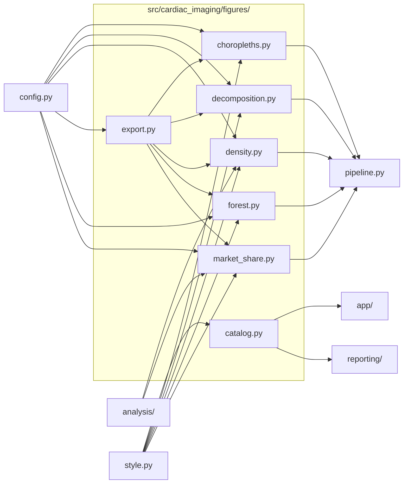

# `src/cardiac_imaging/figures/`

> Figures: every publication figure (1–9, S1–S2, state panel) plus PNG/TIFF export helpers.

[← Project README](../../../README.md)

## How it connects

Solid `A --> B` = B imports A (A feeds B). Dotted = A runs B. Other directories are collapsed to one box.

## Files

| File | What it does |
|---|---|
| [`catalog.py`](catalog.py) | Catalog of every output figure: file stem → label, section, title and caption (feeds the run gallery and PDF). |
| [`choropleths.py`](choropleths.py) | Figures 3–7, 10, 11: state choropleths per modality and comparator procedure (2018 / 2023 / change), plus a 2023 panel. |
| [`decomposition.py`](decomposition.py) | Figure 1: volume vs FFS enrollment vs utilization rate, 3 metrics × 5 imaging modalities + comparators (ICA, TAVR). |
| [`density.py`](density.py) | Figures 8, S1, S2: state CTA rate vs physician density with unadjusted/adjusted NB fits and inline IRRs. |
| [`export.py`](export.py) | Save figures to OUTPUT_DIR as PNG (300 DPI) + LZW TIFF in tiff/, and display them only inside notebooks. |
| [`forest.py`](forest.py) | Figure 9: density IRRs before/after adjustment by specialty; Figure S3: original vs whole-workforce exposure. |
| [`market_share.py`](market_share.py) | Figure 2: modality market share by rural/urban × office/facility, with advanced-modality zoom insets. |

## Functions

Every function and class in this directory, including internal helpers.

**`catalog.py`**
- `_src(kind)` *(internal)* — {'sources': [...], 'tables': [...]} for one chart kind.

**`choropleths.py`**
- `map_stem(proc, fig_num)` — File stem of a state-map figure, e.g. figure4_spect_state_maps.
- `plot_state_maps(state_rates_2018, state_rates_2023, delta_df)` — One 3-panel map figure per modality, numbered 3–7 in PROC_ORDER.
- `plot_comparator_state_maps(label, fig_num, note, state_rates_2018, state_rates_2023, delta_df)` — A comparator's state map (Figures 10–11), same layout as Figures 3–7; states with no 2018 rows are left blank.
- `plot_one_state_map(proc, fig_num, state_rates_2018, state_rates_2023, delta_df, note)` — Draw and save one 3-panel (2018 / 2023 / change) state map for `proc`.
- `plot_all_modalities_panel(state_rates_2023)` — Unnumbered composite of 2023 state rates for all five modalities (optional Central Illustration).

**`decomposition.py`**
- `plot_figure1(decomp_df)` — Draw and save Figure 1 (volume, FFS enrollment and rate per column of FIG1_ORDER present in decomp_df, 3 × n).

**`density.py`**
- `plot_density_fit(fit, title, color, fname, n_physicians, tiff_dpi)` — Single panel: scatter + both NB fits + inline text box with unadjusted and adjusted IRR, CI, p.

**`export.py`**
- `in_notebook()` — True when running inside a Jupyter kernel (figures are then shown inline).
- `out_path(name)` — Path for an output file in OUTPUT_DIR (created if needed).
- `tiff_path(stem)` — Path for a submission TIFF in OUTPUT_DIR/tiff (created if needed).
- `save_pub_fig(fig, stem, tiff_dpi)` — Save a matplotlib figure as working PNG (300 DPI) + submission TIFF (LZW), then show/close it.
- `png_to_tiff(png_path, dpi)` — Convert a plotly PNG export to TIFF (in tiff/) with DPI metadata.
- `save_plotly(fig, filename, width, height, scale)` — Write a plotly figure to PNG (+ TIFF unless disabled) and an interactive HTML copy; shows it in notebooks.

**`forest.py`**
- `plot_forest(rows)` — rows: [(label, share_note, result_dict(irr_un, irr_adj, n_physicians), color), ...].
- `plot_sensitivity_forest(table)` — Figure S3: adjusted per-SD density IRRs, original CTA-biller vs whole-workforce exposure, per specialty group.

**`market_share.py`**
- `plot_figure2(market_data)` — Draw and save Figure 2 (stacked market share per setting with advanced-modality insets).

## Notes

<!-- BEGIN MANUAL -->
<!-- END MANUAL -->

<!-- Generated by scripts/update_readmes.py — edit docstrings, not this file. -->
