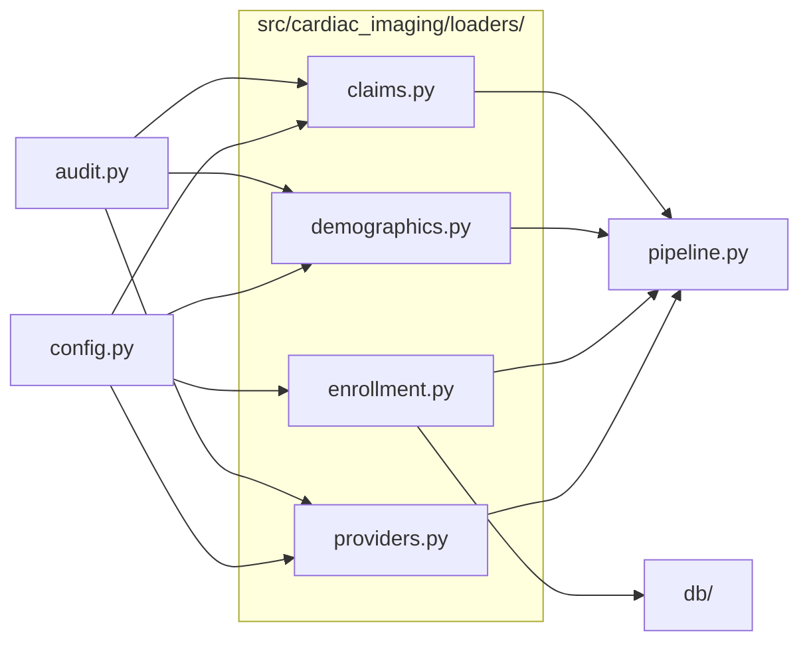

# `src/cardiac_imaging/loaders/`

> Loaders: pull analysis-ready DataFrames out of the database (claims, enrollment, demographics, providers).

[← Project README](../../../README.md)

## How it connects

Solid `A --> B` = B imports A (A feeds B). Dotted = A runs B. Other directories are collapsed to one box.

## Files

| File | What it does |
|---|---|
| [`claims.py`](claims.py) | Claims-level cardiac imaging data: specialty guard, procedure-level detail, segment aggregates. |
| [`demographics.py`](demographics.py) | State mean age and % female from the CMS Geographic Variation PUF (model covariates). |
| [`enrollment.py`](enrollment.py) | State-level Original Medicare (FFS) enrollment: parse CMS workbooks at upload, read back as {state: ffs}. |
| [`providers.py`](providers.py) | CTA-billing physician density by state (all / radiology / cardiology) and national NPI counts, 2023. |

## Functions

**`claims.py`**
- `verify_specialty_strings(con)` — Every specialty string must exist verbatim in the PUF.
- `load_detail(con)` — One row per provider × HCPCS × year for the 5 cardiac modalities (territories excluded).
- `aggregate_segments(df_detail)` — Services and unique NPIs by year × modality × rural/urban × place of service (Unknown RUCA dropped).
- `national_trend(df_agg)` — Total services by year × modality.

**`demographics.py`**
- `load_gv_demographics(con, year)` — DataFrame(state, mean_age, pct_female) for 50 states + DC in `year`.

**`enrollment.py`**
- `parse_enrollment_2023(raw)` — Raw 2023 CMS workbook (header=None, skiprows=4) → DataFrame(year, state, ffs).
- `parse_enrollment_2018(raw)` — Raw 2018 CMS workbook (header=None, skiprows=4) → DataFrame(year, state, ffs).
- `load_state_ffs(con, year)` — {state: FFS enrollment} for one year, from ENROLLMENT_TABLE.

**`providers.py`**
- `load_cta_density_frames(con, state_ffs, demo)` — State-level CTA volume + NPI density + demographics, keyed 'all', 'rad', 'card'.
- `national_physician_counts(con)` — COUNT(DISTINCT NPI) across all states combined — multi-state billers counted once.
- `report_states_without_billers(state_ffs, frames)` — Print which of the 50 states + DC had zero CTA billers of each specialty.

## Notes

<!-- BEGIN MANUAL -->
<!-- END MANUAL -->

<!-- Generated by scripts/update_readmes.py — edit docstrings, not this file. -->
