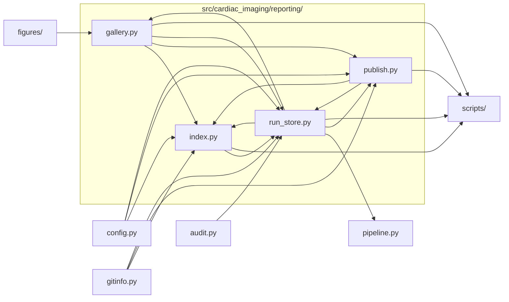

# `src/cardiac_imaging/reporting/`

> Reporting: one folder per run (figures, tables, log, manifest), a chart gallery + PDF per run, and an index of all runs.

[← Project README](../../../README.md)

## How it connects

Solid `A --> B` = B imports A (A feeds B). Dotted = A runs B. Other directories are collapsed to one box.

## Files

| File | What it does |
|---|---|
| [`gallery.py`](gallery.py) | Per-run gallery.html (every chart, grouped by section, with a full-screen viewer and results tables) and all_figures.pdf. |
| [`index.py`](index.py) | RUNS_DIR/index.html: every run — local and on GitHub — with timestamps, code snapshot, data, headline IRRs and links. |
| [`publish.py`](publish.py) | Upload a run to GitHub as a Release on its code-snapshot tag (outputs zipped as assets), and download runs back. |
| [`run_store.py`](run_store.py) | Per-run output folder RUNS_DIR/<timestamp>_<commit>/: figures/, tables/, console.log, manifest.json, plus a code-snapshot tag. |

## Functions

**`gallery.py`**
- `esc(x)`
- `fmt_num(v)` — Compact number format for result tables.
- `table_html(csv_path)`
- `figure_list(run_dir)` — Catalog entries for this run (in catalog order), plus any uncatalogued PNGs under 'Other'.
- `make_thumbs(run_dir, figs, width)` — figures/thumbs/<stem>.png at `width` px for the grid; the full-resolution PNG opens in the viewer.
- `headline_cards(m)`
- `details_html(m, repo)` — Run details panel: code snapshot + restore command, GitHub upload, data, versions.
- `compare_note(m, runs_dir)` — One line comparing headline numbers with the previous successful run.
- `build(run_dir)` — Write gallery.html and all_figures.pdf into run_dir from its manifest.json, figures/ and tables/.
- `build_pdf(run_dir, m, figs, max_px)` — all_figures.pdf: a cover page, then one landscape page per chart with its label and title.

**`index.py`**
- `build(runs_dir)` — Rewrite index.html in runs_dir: local run summaries embedded, GitHub releases merged in by the page itself.

**`publish.py`**
- `summary(m)` — The subset of a manifest shown in index.html (also embedded in the release notes).
- `release_notes(m)`
- `publish_run(run_dir, force)` — Push the run's tag and create its GitHub Release with the outputs attached; records `published` in the manifest.
- `remote_runs()` — Run summaries decoded from the GitHub releases' notes (newest first), each with its release URL and time.
- `fetch_run(run_id, runs_dir)` — Download a published run's outputs (run_*.zip) from GitHub and unpack them into runs_dir.

**`run_store.py`**
- `data_fingerprint(parquet_dir)` — Names, sizes and mtimes of the Parquet inputs, hashed — changes whenever the input data changes.
- `package_versions()`
- `tag_for(run_id)`
- `Run()` — Context for one pipeline run: snapshots the code, redirects figures into the run folder, tees the console.
- `read_manifest(run_dir)`
- `write_manifest(run_dir, m)`
- `list_runs(runs_dir)` — Manifests of every run in runs_dir, newest first.

## Notes

<!-- BEGIN MANUAL -->
<!-- END MANUAL -->

<!-- Generated by scripts/update_readmes.py — edit docstrings, not this file. -->
