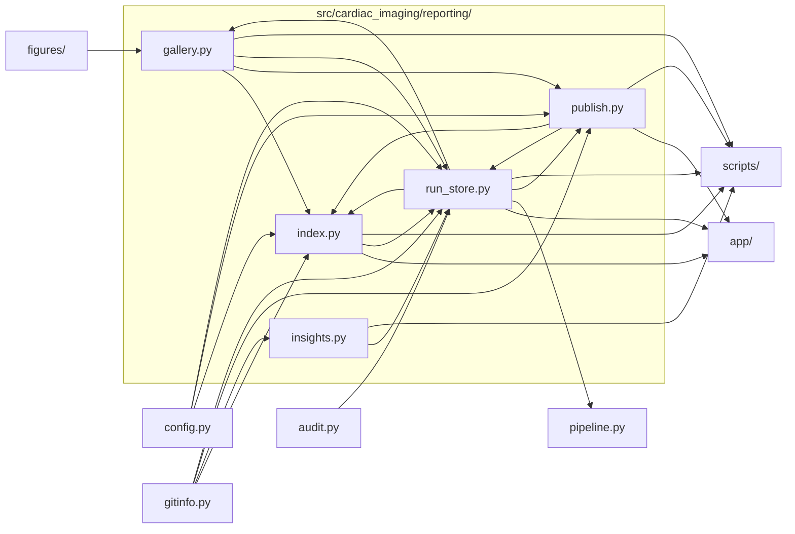

# `src/cardiac_imaging/reporting/`

> Reporting: one folder per run (figures, tables, log, manifest), a chart gallery + PDF per run, and an index of all runs.

[← Project README](../../../README.md)

## How it connects

Solid `A --> B` = B imports A (A feeds B). Dotted = A runs B. Other directories are collapsed to one box.

## Files

| File | What it does |
|---|---|
| [`gallery.py`](gallery.py) | Per-run gallery.html (every chart, grouped by section, with a full-screen viewer and results tables) and all_figures.pdf. |
| [`index.py`](index.py) | RUNS_DIR/index.html: results history — when each run happened, what it found (plain English), what changed, one-click restore. |
| [`insights.py`](insights.py) | Plain-English run summaries: key findings from a run's tables, and what changed (and its impact) vs the previous run. |
| [`publish.py`](publish.py) | Upload a run to GitHub as a Release on its code-snapshot tag (outputs zipped as assets), and download runs back. |
| [`run_store.py`](run_store.py) | Per-run output folder RUNS_DIR/<timestamp>_<commit>/: figures/, tables/, console.log, manifest.json, plus a code-snapshot tag. |

## Functions

Every function and class in this directory, including internal helpers.

**`gallery.py`**
- `_when(iso)` *(internal)* — 'Thu Oct 23, 2026, 10:44 PM' from an ISO timestamp (empty string if missing).
- `esc(x)` — HTML-escape any value.
- `fmt_num(v)` — Compact number format for result tables.
- `table_html(csv_path)` — Render a results CSV as an HTML table with compact number formatting.
- `figure_list(run_dir)` — Catalog entries for this run (in catalog order), plus any uncatalogued PNGs under 'Other'.
- `make_thumbs(run_dir, figs, width)` — figures/thumbs/<stem>.png at `width` px for the grid; the full-resolution PNG opens in the viewer.
- `headline_cards(m)` — HTML stat cards for headline IRRs, steps completed and figure count.
- `details_html(m, repo)` — Run details panel: code snapshot + restore command, GitHub upload, data, versions.
- `summary_html(m)` — Top-of-page card: the run's plain-English summary, plus what changed since the previous run and its impact.
- `development_html(m, repo, steps_rows, files)` — Bottom-of-page Development tab (collapsed): run details, pipeline steps and files — for reproducing or debugging.
- `compare_note(m, runs_dir)` — One line comparing headline numbers with the previous successful run.
- `build(run_dir)` — Write gallery.html and all_figures.pdf into run_dir from its manifest.json, figures/ and tables/.
- `build_pdf(run_dir, m, figs, max_px)` — all_figures.pdf: a cover page, then one landscape page per chart with its label and title.

**`index.py`**
- `build(runs_dir)` — Rewrite index.html in runs_dir: local run summaries embedded; GitHub runs and app actions loaded by the page.

**`insights.py`**
- `_read(run_dir, name)` *(internal)* — A saved results table, or None when the run didn't produce it.
- `findings(run_dir)` — Key numbers from a run's tables: utilization change per modality, advanced share, IRRs, CTA reader shares.
- `_pct(v)` *(internal)* — '+199%' / '−34%' style percentage.
- `english_summary(m)` — Two to four plain-English sentences describing a run's outcome and main results.
- `_changed(a, b, tol)` *(internal)* — True when two numbers differ by more than `tol` (or one is missing).
- `compare(m, prev)` — What changed since `prev` (code, data, settings) and the impact on results, as plain-English lines + structured data.
- `annotate(run_dir, m, prev)` — Add findings, the English summary and the comparison with `prev` to manifest `m` (in place) and return it.

**`publish.py`**
- `_gh()` *(internal)* — Run a `gh` CLI command against this repo (optionally returning its output).
- `summary(m)` — The subset of a manifest shown in index.html (also embedded in the release notes).
- `release_notes(m)` — Markdown release notes for a run: summary table, headline IRRs, restore command, embedded run record.
- `_zip(run_dir, out, include_tiff)` *(internal)* — Zip run_dir as <run_id>/... ; TIFFs go only in the TIFF zip.
- `_push_tag(tag)` *(internal)* — Push one tag (and the snapshot commit it points to) to GitHub.
- `publish_run(run_dir, force)` — Push the run's tag and create its GitHub Release with the outputs attached; records `published` in the manifest.
- `update_release_notes(run_dir)` — Rewrite an existing GitHub release's notes from the run's current manifest (e.g. after refreshing summaries).
- `remote_runs()` — Run summaries decoded from the GitHub releases' notes (newest first), each with its release URL and time.
- `_gh_api_releases()` *(internal)* — All of the repo's releases from the GitHub API (all pages).
- `fetch_run(run_id, runs_dir)` — Download a published run's outputs (run_*.zip) from GitHub and unpack them into runs_dir.

**`run_store.py`**
- `class _Tee` *(internal)* — Write to the real stream and the run's console.log at the same time.
- `_Tee.__init__(stream, log)` *(internal)* — Remember the real stream and the log file.
- `_Tee.write(s)` — Write text to both the real stream and the log.
- `_Tee.flush()` — Flush both streams.
- `_Tee.__getattr__(name)` *(internal)* — Delegate any other attribute to the real stream.
- `_link(link, target)` *(internal)* — Create/refresh symlink `link` → `target` (no-op on failure; links are a convenience).
- `data_fingerprint(parquet_dir)` — Names, sizes and mtimes of the Parquet inputs, hashed — changes whenever the input data changes.
- `package_versions()` — Installed versions of Python and the key analysis packages.
- `tag_for(run_id)` — Git tag name holding the code snapshot of a run.
- `class Run` — Context for one pipeline run: snapshots the code, redirects figures into the run folder, tees the console.
- `Run.__init__(label)` *(internal)* — Create the run folder, snapshot + tag the code, start teeing the console.
- `Run.log_step(name, seconds, ok)` — Record one pipeline step's duration and status.
- `Run.save_tables(tables)` — Write each DataFrame in `tables` to tables/<name>.csv.
- `Run.finish(ctx, error, publish)` — Restore stdout, write manifest.json, build gallery + PDF, publish to GitHub (if enabled), refresh the index.
- `_try(fn, what)` *(internal)* — Run a reporting step, printing (not raising) any failure.
- `_filter_table()` *(internal)* — The current run's filter log as a DataFrame (empty dict if nothing was filtered).
- `read_manifest(run_dir)` — Load a run folder's manifest.json.
- `write_manifest(run_dir, m)` — Write a run folder's manifest.json.
- `previous_run(run_id, runs_dir)` — Manifest of the most recent run started before `run_id` (None if it is the first).
- `list_runs(runs_dir)` — Manifests of every run in runs_dir, newest first.

## Notes

<!-- BEGIN MANUAL -->
<!-- END MANUAL -->

<!-- Generated by scripts/update_readmes.py — edit docstrings, not this file. -->
