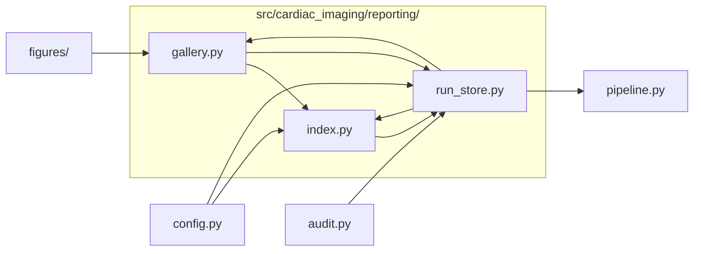

# `src/cardiac_imaging/reporting/`

> Reporting: one folder per run (figures, tables, log, manifest), a chart gallery + PDF per run, and an index of all runs.

[← Project README](../../../README.md)

## How it connects

Solid `A --> B` = B imports A (A feeds B). Dotted = A runs B. Other directories are collapsed to one box.

## Files

| File | What it does |
|---|---|
| [`gallery.py`](gallery.py) | Per-run gallery.html (every chart, grouped by section, with a full-screen viewer and results tables) and all_figures.pdf. |
| [`index.py`](index.py) | RUNS_DIR/index.html: every run, newest first, with status, commit, headline IRRs and links to its gallery, PDF and log. |
| [`run_store.py`](run_store.py) | Per-run output folder RUNS_DIR/<timestamp>_<commit>/: figures/, tables/, console.log and manifest.json. |

## Functions

**`gallery.py`**
- `esc(x)`
- `fmt_num(v)` — Compact number format for result tables.
- `table_html(csv_path)`
- `figure_list(run_dir)` — Catalog entries for this run (in catalog order), plus any uncatalogued PNGs under 'Other'.
- `make_thumbs(run_dir, figs, width)` — figures/thumbs/<stem>.png at `width` px for the grid; the full-resolution PNG opens in the viewer.
- `headline_cards(m)`
- `compare_note(m, runs_dir)` — One line comparing headline numbers with the previous successful run.
- `build(run_dir)` — Write gallery.html and all_figures.pdf into run_dir from its manifest.json, figures/ and tables/.
- `build_pdf(run_dir, m, figs, max_px)` — all_figures.pdf: a cover page, then one landscape page per chart with its label and title.

**`index.py`**
- `build(runs_dir)` — Rewrite index.html in runs_dir from the manifests of all runs.

**`run_store.py`**
- `Run()` — Context for one pipeline run: redirects figures into the run folder and tees the console into it.
- `list_runs(runs_dir)` — Manifests of every run in runs_dir, newest first.

## Notes

<!-- BEGIN MANUAL -->
<!-- END MANUAL -->

<!-- Generated by scripts/update_readmes.py — edit docstrings, not this file. -->
