# `tests/`

> Test suite (pytest): synthetic-data tests for every layer + real-data regression tests that pin published numbers.

[← Project README](../README.md)

## How it connects

Solid `A --> B` = B imports A (A feeds B). Dotted = A runs B. Other directories are collapsed to one box.

```mermaid
flowchart LR
  subgraph here["tests/"]
    n_conftest_py["conftest.py"]
    n_synthetic_py["synthetic.py"]
    n_test_analysis_py["test_analysis.py"]
    n_test_app_py["test_app.py"]
    n_test_config_py["test_config.py"]
    n_test_db_py["test_db.py"]
    n_test_github_integration_py["test_github_integration.py"]
    n_test_gitinfo_restore_py["test_gitinfo_restore.py"]
    n_test_loaders_py["test_loaders.py"]
    n_test_markdown_py["test_markdown.py"]
    n_test_pipeline_py["test_pipeline.py"]
    n_test_real_data_py["test_real_data.py"]
    n_test_reporting_py["test_reporting.py"]
    n_test_scripts_py["test_scripts.py"]
    n_test_sync_py["test_sync.py"]
  end
```

## Files

| File | What it does |
|---|---|
| [`conftest.py`](conftest.py) | Shared fixtures: every test runs isolated (temp repo/run/conversation dirs, GitHub uploads off, no real tags). |
| [`synthetic.py`](synthetic.py) | Deterministic synthetic cms.duckdb built from the data model (db/schema.py), small enough for fast tests. |
| [`test_analysis.py`](test_analysis.py) | Analysis: rates, change summary, market share, state tables, Table 1, and the NB density models. |
| [`test_app.py`](test_app.py) | Local app: chart-discussion context and conversations, chat backends, and the HTTP server's API + security. |
| [`test_config.py`](test_config.py) | Invariants of the single source of truth (config.py) and the figure catalog. |
| [`test_db.py`](test_db.py) | Data model validation, connection rules, and building tables from raw files. |
| [`test_github_integration.py`](test_github_integration.py) | GitHub-facing code with GitHub simulated: publishing runs, reading them back, downloading, error issues, API chat. |
| [`test_gitinfo_restore.py`](test_gitinfo_restore.py) | Code snapshots and one-click restore/undo, in a throwaway git repo. |
| [`test_loaders.py`](test_loaders.py) | Loaders: claims detail and filters, enrollment parsing, GV demographics, provider density. |
| [`test_markdown.py`](test_markdown.py) | Markdown rendering for chat replies: the basic elements render, and nothing in a reply can inject HTML or scripts. |
| [`test_pipeline.py`](test_pipeline.py) | End-to-end: a full recorded run on synthetic data, plus failure handling. |
| [`test_real_data.py`](test_real_data.py) | Regression tests on the real CMS data (skipped when ~/Downloads/cms_parquet/cms.duckdb is absent, e.g. in CI). |
| [`test_reporting.py`](test_reporting.py) | Reporting: audit log, summaries/comparisons, gallery, index, release notes, publishing helpers. |
| [`test_scripts.py`](test_scripts.py) | Repository scripts: docstring rule, README generation, hypothesis consolidation, work log. |
| [`test_sync.py`](test_sync.py) | Run sync between laptops and reliable GitHub releases (GitHub is faked — no network). |

## Functions

Every function and class in this directory, including internal helpers.

**`conftest.py`**
- `git(repo)` — Run git in `repo` and return stdout.
- `make_repo(path)` — A throwaway git repo with one commit (src/app.py) and a test identity.
- `isolated(tmp_path, monkeypatch)` — Point every writable location at tmp dirs and disable GitHub side effects for the duration of a test.
- `synthetic_db(tmp_path_factory)` — Path to a synthetic cms.duckdb shared by all tests (read-only use).
- `con(synthetic_db)` — Read-only connection to the synthetic database.
- `stub_plotly(monkeypatch)` — Replace plotly's PNG export (needs Chrome/kaleido) with a tiny PNG so map figures still produce files.
- `pipeline_run(tmp_path_factory, synthetic_db)` — One full recorded pipeline run on synthetic data (shared; inspect its outputs, don't modify them).

**`synthetic.py`**
- `claims_frame(seed)` — Synthetic Physician & Other Practitioners rows covering every filter the pipeline applies.
- `enrollment_frame()` — FFS enrollment for 50 states + DC in 2018 and 2023 (no territories, no AA).
- `gv_frame()` — Raw GV PUF rows (all text) with national, territory, age-band, name/postal/FIPS-only and suppressed cases.
- `build(path, claims)` — Write the three tables to a DuckDB file at `path` with the data model's column types; returns the path.

**`test_analysis.py`**
- `_trend()` *(internal)* — Year × modality totals with simple known numbers.
- `test_decompose_rate_per_1000()` — Rate = services / national FFS enrollment × 1000.
- `test_change_summary_matches_hand_calculation()` — 2018→2023 % change computed per modality; enrollment change identical for all.
- `test_change_summary_adds_ica_after_imaging_modalities()` — With ICA in the trend, it is the last row of the change summary; imaging rows are unchanged.
- `test_print_change_summary_format(capsys)` — Console table keeps its original layout.
- `test_market_shares_sum_to_100(con)` — Each segment's yearly shares sum to 100; national shares add Traditional + Advanced.
- `test_state_rates_and_deltas()` — State rates drop states without (or with zero) enrollment, log them, and deltas fill missing years with 0.
- `test_state_summary_table_sorted()` — All Cardiac = sum of modality rates, sorted descending.
- `test_table1_shares(con)` — Specialty shares sum to 100 per modality; CTA shares come straight from Table 1.
- `_nb_data(n, irr, seed)` *(internal)* — Simulated state data with a known density IRR (NB2).
- `test_nb_recovers_known_irr()` — The adjusted density IRR is close to the simulated truth and its CI contains it.
- `test_irr_and_partial_curve_properties()` — CIs bracket the estimate; the partial curve rises with density when IRR > 1 and its band contains it.
- `test_nb_requires_ten_states()` — Fewer than 10 states with demographics is refused.
- `test_results_table_and_report(capsys)` — results_table has one row per model with adjusted and unadjusted IRRs; the report prints the key lines.

**`test_app.py`**
- `run_copy(pipeline_run, monkeypatch, isolated)` — A private copy of the synthetic run inside this test's RUNS_DIR (so tests can write conversations etc.).
- `test_context_uses_code_at_snapshot(run_copy)` — Chart context includes the plotting function source, related tables and the data model.
- `test_function_source_missing_returns_empty()` — Unknown functions yield empty source rather than an error.
- `test_unknown_chart()` — Unknown chart stems raise KeyError.
- `class EchoBackend` — Fake backend that echoes, for testing the conversation flow.
- `EchoBackend.reply(conv, message, ctx)` — Echo the message with the chart label.
- `test_conversation_flow_and_outcome(run_copy)` — Messages are saved; follow-ups append to the same conversation; outcomes are validated and stored.
- `test_backend_errors_are_shown_not_raised(run_copy)` — A failing backend produces a ⚠️ message instead of crashing.
- `test_handoff_backend_gives_full_prompt(run_copy, monkeypatch)` — Without a model, the reply is a ready-made prompt containing the code and the hypothesis, plus setup steps.
- `test_setup_hint_when_bundled_cli_not_logged_in(monkeypatch)` — If Claude Code is present but logged out, the hint gives the exact one-time login command for that binary.
- `test_claude_binary_prefers_path_then_newest_bundled(tmp_path, monkeypatch)` — `claude` on PATH wins; otherwise the newest version bundled with the desktop app is used.
- `test_claude_logged_in_reads_auth_status(tmp_path, monkeypatch)` — Login state comes from `auth status` JSON; errors count as logged out; results are cached briefly.
- `test_claude_code_backend_unavailable_when_logged_out(monkeypatch)` — A logged-out CLI doesn't count as an available backend (so auto falls back instead of erroring).
- `test_backend_selection(monkeypatch)` — auto picks Claude Code when installed, else the API when configured, else hand-off.
- `test_claude_code_backend_command(run_copy, monkeypatch)` — The CLI is called read-only with the context on turn 1 and --resume afterwards.
- `app(run_copy)` — Running app server on a free port; yields (base_url, run_id).
- `_req(url, body, token, host)` *(internal)* — (status, json) for a GET (body None) or POST.
- `test_server_serves_index_and_gallery(app)` — Static pages are served from RUNS_DIR.
- `test_server_session_context_and_chat(app)` — Session gives a token; context returns code; chat works with the token and is refused without it.
- `test_server_rejects_foreign_host_and_bad_input(app)` — DNS-rebinding style Host headers are refused; bad requests give 400; unknown routes 404.
- `test_server_restore_endpoint(app)` — POST /api/restore restores the run's code in the repo and returns an undoable backup tag.
- `test_cli_calls_never_inherit_stdin(monkeypatch)` — Both CLI calls pass stdin=DEVNULL (an inherited open stdin made `claude` hang until the timeout).
- `_claude_code_conv(run_copy, monkeypatch)` *(internal)* — A saved conversation answered by a (fake) Claude Code backend, with a session id.
- `test_open_in_claude_app_hands_off_and_follow_ups_fork(run_copy, monkeypatch)` — `--desktop --resume <session>` runs under a pseudo-terminal; later panel messages fork instead of interleaving.
- `test_open_in_claude_app_errors(run_copy, monkeypatch)` — Copy-paste conversations can't be handed off; a refusal from the app is reported in plain words.
- `test_open_desktop_uses_pty_and_no_stdin(monkeypatch)` — The desktop hand-off runs through `script` (a pseudo-terminal) with stdin closed.
- `test_server_open_in_app_endpoint(app, monkeypatch)` — POST /api/open-in-app returns 409 with a readable message when the conversation can't be handed off.
- `test_server_label_endpoint(app)` — POST /api/label saves the label (not synced for unpublished runs), clears it, and rejects unknown labels.

**`test_config.py`**
- `test_population_rules()` — Territories and invalid codes are excluded; specialty groups don't overlap.
- `test_geography_lookups_cover_50_states_plus_dc()` — Name and FIPS lookups agree on the same 51 jurisdictions.
- `test_study_window_and_enrollment()` — National enrollment exists for every study year.
- `test_modality_sql_maps_every_cardiac_code()` — Every code in the HCPCS filter is assigned a modality and a modality type.
- `test_pet_codes_are_perfusion_pet_with_and_without_ct()` — Cardiac PET = 78491, 78492, 78430, 78431 (Advanced); add-on 78434 and metabolic/combined codes are not counted.
- `test_relative_env_paths_resolve_inside_repo(monkeypatch)` — CARDIAC_* relative paths are resolved against the repo root.
- `test_catalog_entries_are_complete_and_unique()` — Every figure has a unique stem, a known section, and code + table references.
- `test_catalog_sources_point_at_real_functions()` — Each 'module:function' in the catalog exists (so chart discussions load real code).
- `test_load_dotenv_fills_unset_vars_only(tmp_path, monkeypatch)` — .env values (quoted or not, with comments) fill unset variables but never override ones already set.
- `test_setup_script_is_valid_bash_and_documents_steps()` — scripts/setup_laptop.sh parses, never deletes anything, and covers every setup step.

**`test_db.py`**
- `test_synthetic_db_matches_data_model(con)` — The synthetic database (built from the schema) validates cleanly.
- `test_validate_reports_missing_wrong_and_extra(tmp_path)` — validate() names missing tables, wrong types, missing and undocumented columns.
- `test_schema_documents_every_used_column()` — Each table lists columns with a type, a meaning and a used flag; key analysis columns are flagged used.
- `test_read_only_connection_requires_existing_file(tmp_path)` — Opening a missing local database read-only fails with a helpful message.
- `test_motherduck_needs_token(monkeypatch)` — md: databases require MOTHERDUCK_TOKEN.
- `test_require_tables(con, tmp_path)` — require_tables passes on a full DB and names what's missing otherwise.
- `test_connection_is_read_only(synthetic_db)` — Analysis connections can't write.
- `test_build_claims_view_from_parquet(tmp_path)` — build_claims_table creates a view over YYYY__*.parquet with year taken from the file name.
- `test_build_claims_without_parquet_fails(tmp_path)` — A clear error when no Parquet files exist.
- `test_load_gv_puf_keeps_all_columns_as_text(tmp_path)` — The GV PUF is stored raw, every column VARCHAR.

**`test_github_integration.py`**
- `run_dir(pipeline_run, isolated, monkeypatch)` — Private copy of the synthetic run and its repo, with a fake GitHub remote.
- `class FakeGh` — Records gh/git invocations and answers `release view` like GitHub would.
- `FakeGh.__init__()` *(internal)* — Start with no calls.
- `FakeGh.gh()` — Fake publish._gh.
- `test_publish_run_creates_release_and_records_it(run_dir, monkeypatch)` — publish_run pushes the tag, uploads zips/PDF/manifest with notes, and stores the release info.
- `test_update_notes_skips_unpublished(run_dir)` — Unpublished runs have no release notes to update.
- `test_remote_runs_decodes_release_records(monkeypatch)` — Runs are rebuilt from release bodies; releases without a record are ignored.
- `_fake_download(zip_members)` *(internal)* — A fake `gh release download` that writes a zip with the given members into --dir.
- `test_fetch_run_unpacks_into_runs_dir(monkeypatch)` — A GitHub-only run is downloaded and unpacked as <runs_dir>/<run id>/.
- `test_fetch_run_rejects_unsafe_archives(monkeypatch)` — Archives with paths outside the run folder are refused.
- `test_gh_missing(monkeypatch)` — A clear error when the GitHub CLI isn't installed.
- `test_error_report_and_issue(monkeypatch)` — report() writes the log; with a token it opens an issue, or comments when one is already open.
- `test_anthropic_backend_with_fake_sdk(pipeline_run, monkeypatch, isolated)` — The API backend sends the image on turn 1, keeps full content blocks, and handles refusals.

**`test_gitinfo_restore.py`**
- `test_snapshot_clean_repo_is_head()` — A clean working tree snapshots to HEAD itself.
- `test_snapshot_captures_uncommitted_and_untracked_without_touching_index()` — Edits and new files are frozen in a commit; the real index, branch and files are unchanged.
- `test_ensure_tag_is_idempotent()` — ensure_tag creates an annotated tag once and leaves it alone afterwards.
- `test_commit_info_and_repo_slug(monkeypatch)` — commit_info reads subject/author/date; repo_slug parses GitHub remotes and honours GITHUB_REPOSITORY.
- `_tag_run(run_id, version)` *(internal)* — Commit a version of src/app.py, tag it as a run snapshot, return the commit.
- `test_restore_then_undo_round_trip()` — Restore puts files back to the run's version with a new commit and a backup tag; Undo returns to the backup.
- `test_restore_noop_when_identical()` — Restoring the version you're already on changes nothing.
- `test_restore_refuses_detached_head_and_unknown_runs()` — Plain-English errors for a detached HEAD, an unknown run and a non-backup undo.
- `test_status_reports_dirty()` — status() shows branch, head and uncommitted edits.

**`test_loaders.py`**
- `test_specialty_guard(con)` — Passes when every specialty string exists; fails loudly when one is missing.
- `test_load_detail_filters_and_classifies(con)` — Only cardiac codes, no territories/invalid states, RUCA cast to Urban/Rural/Unknown, every row has a modality.
- `test_load_ica_detail_and_trend(con)` — ICA rows: only 93454–93461, territories excluded and logged; trend has one row per year.
- `test_ruca_threshold_matches_numeric_comparison(con)` — VARCHAR RUCA is compared numerically: ≤3 Urban, >3 Rural.
- `test_aggregate_segments_drops_unknown_and_logs(con)` — Segment aggregates exclude Unknown RUCA and log the services dropped.
- `_raw_2023()` *(internal)* — A tiny raw 2023 enrollment sheet with junk rows and a territory.
- `test_parse_enrollment_2023()` — Keeps states, drops header/total/notes rows and territories, converts FFS to int.
- `test_parse_enrollment_2018_with_extra_columns()` — Works when the 2018 sheet has more columns than named.
- `test_load_state_ffs(con)` — Returns {state: ffs} for a year and fails for a missing year.
- `test_gv_demographics_resolution_and_cleaning(con)` — States resolved from name, postal code or FIPS; fractions → %; territories, age bands and other years dropped.
- `test_gv_missing_year(con)` — Asking for a year not in the file fails with the available years.
- `test_num_parses_cms_text()` — Percent signs, thousands separators and suppression markers are handled.
- `test_cta_density_frames(con)` — Density frames drop states lacking enrollment (AA) or specialty billers (AK/SD, DE/WY) and carry demographics.
- `test_national_counts_deduplicate_multistate_npis(con)` — National unique NPI counts never exceed the sum of per-state counts; specialty counts ≤ all.
- `test_states_without_billers(con, capsys)` — Missing-biller report lists exactly the synthetic gaps.

**`test_markdown.py`**
- `test_paragraphs_and_line_breaks()` — Blank lines separate paragraphs; single newlines become  .
- `test_inline_formatting()` — Bold, italic, strikethrough and inline code.
- `test_snake_case_and_arithmetic_are_not_emphasis()` — Identifiers like fit_density_models and expressions like 2 * 3 * 4 stay literal.
- `test_headings_are_chat_sized()` — # → h3 … #### → h6 (capped).
- `test_lists_nested_and_ordered()` — Bulleted, numbered and nested lists, including wrapped continuation lines.
- `test_code_block_is_escaped_and_tagged()` — Fenced code keeps its content verbatim (escaped) with a language class.
- `test_unclosed_code_block_runs_to_end()` — A missing closing fence still renders everything after it as code.
- `test_table()` — Pipe tables with a separator row become HTML tables; inline formatting works in cells.
- `test_blockquote_and_rule()` — Quotes (may contain other Markdown) and horizontal rules.
- `test_links_safe_and_unsafe()` — http(s)/mailto/relative links become anchors; javascript: and data: links stay plain text; URLs aren't mangled.
- `test_html_and_scripts_are_never_executed()` — Raw HTML in a reply is escaped wherever it appears — text, headings, lists, tables, quotes, link text.
- `test_link_url_cannot_break_out_of_attribute()` — Quotes in a URL are escaped, so they can't add attributes.
- `test_empty_and_none()` — Empty input renders to an empty string.

**`test_pipeline.py`**
- `test_run_completes_every_step(pipeline_run)` — All steps succeed and the manifest says so.
- `test_run_produces_every_catalogued_figure(pipeline_run)` — Each catalog entry has a PNG and a thumbnail; nothing uncatalogued is produced.
- `test_run_saves_tables_and_records(pipeline_run)` — Result tables, console log, filter log, headline IRRs, findings and an English summary are saved.
- `test_run_snapshot_tag_and_reports(pipeline_run)` — The code snapshot is tagged; gallery, PDF and index are built; `latest` points at the run.
- `test_failure_is_recorded(synthetic_db, tmp_path, monkeypatch)` — A failing step marks the run failed, names the step, writes logs/last_error.md, and re-raises.
- `test_no_record_mode(synthetic_db, stub_plotly)` — record=False writes figures to OUTPUT_DIR and creates no run folder.
- `test_tiffs_when_enabled(synthetic_db, stub_plotly, monkeypatch)` — With SAVE_TIFF on, matplotlib and plotly figures get TIFF copies in figures/tiff/.

**`test_real_data.py`**
- `test_real_database_matches_data_model()` — The live database still matches db/schema.py.
- `real_run(tmp_path_factory)` — One full run on the real data (no TIFFs, not published, isolated folders).
- `test_headline_irrs_unchanged(real_run)` — Adjusted density IRRs and CIs match the published values to 4 decimals.
- `test_table1_cta_shares_unchanged(real_run)` — Radiologists read 59.1% and cardiologists 37.2% of cardiac CTAs in 2023.
- `test_physician_counts_and_states(real_run)` — Model sizes: 51 / 49 / 46 states; 2,847 / 1,616 / 1,140 unique physicians.
- `test_change_summary_unchanged(real_run)` — 2018→2023 rate change per modality (PET = 78491/78492/78430/78431 since 2026-10-24; was −34.4 without PET/CT).
- `test_manifest_records_real_rows(real_run)` — The run records all 58,853,705 claim rows.

**`test_reporting.py`**
- `test_log_filter_records_and_prints(capsys)` — log_filter returns `after`, records an entry and prints dropped items.
- `test_findings_and_summary_from_run(pipeline_run)` — Findings are read from the run's tables and turned into plain English.
- `test_summary_for_failed_run()` — A failed run's summary names the step and suggests what to do.
- `_run(run_id, irr, snap, fp, figs, status, tiff)` *(internal)* — Minimal manifest dict for comparison tests.
- `test_compare_no_previous()` — The first run says there's nothing to compare.
- `test_compare_detects_result_data_figure_and_setting_changes()` — Changed IRRs, data, figures, status and TIFF setting all show up in plain English.
- `test_compare_unchanged_results()` — Identical findings → 'No change in results'.
- `test_compare_code_changes_between_snapshots(isolated)` — Commits and files between the two snapshots are listed.
- `test_gallery_html(pipeline_run)` — Gallery lists every chart with zoom + discuss buttons, the run details panel and the viewer controls.
- `test_gallery_layout_summary_top_development_bottom(pipeline_run)` — The run's English summary is the first section; run details/steps/files sit in a collapsed Development tab at the end.
- `test_fmt_num()` — Compact number formatting for tables.
- `test_index_embeds_runs_and_actions(pipeline_run)` — Index embeds each run's summary and offers open / what-changed / restore actions.
- `test_release_notes_roundtrip(pipeline_run)` — Release notes carry the English summary, what changed, restore command and a decodable run record.
- `test_zip_splits_tiffs(tmp_path)` — Outputs zip excludes TIFFs; TIFF zip contains only TIFFs; paths are rooted at the run id.
- `test_publish_requires_snapshot(tmp_path)` — Publishing a run without a code snapshot is refused with guidance.
- `test_previous_run_and_list(tmp_path)` — list_runs is newest first; previous_run finds the run before a given id.
- `test_data_fingerprint_changes_with_files(tmp_path)` — The data fingerprint changes when a Parquet file changes.
- `test_save_tables(tmp_path)` — Run.save_tables writes CSVs and registers them in the manifest (via a stub Run).
- `test_set_label_store_clear_and_validate(tmp_path)` — Labels are saved in the manifest, can be cleared, must be known, and need the run to be local.
- `test_label_travels_to_github_notes_and_index(pipeline_run, tmp_path)` — A label appears in the release notes and in the run record the landing page reads (local and from GitHub).
- `test_landing_page_structure(pipeline_run)` — Landing page: app bar, search, filters incl. Archived, run list + detail pane, label controls, keyboard hints.
- `test_figure_title_above_chart(pipeline_run)` — Each card shows the figure label and title above the image, caption below.

**`test_scripts.py`**
- `load(name)` — Import scripts/<name>.py as a module.
- `test_every_function_has_a_docstring()` — The pre-commit rule holds for the whole repo right now.
- `test_check_docs_flags_missing(tmp_path)` — Modules, functions, classes and methods without docstrings are reported; nested helpers are exempt.
- `test_readmes_are_current()` — Committed READMEs match what the generator produces (CI fails if someone forgets to regenerate).
- `test_readmes_document_every_function_and_the_data_model()` — Each source directory README lists every function; db/README has the data model with column usage.
- `test_readme_manual_block_survives(tmp_path)` — Hand-written text inside the MANUAL markers is preserved across regenerations.
- `_transcript(path, messages)` *(internal)* — Write a minimal Claude Code JSONL transcript with the given user messages.
- `test_consolidate_hypotheses(tmp_path, monkeypatch)` — Chart discussions become tested hypotheses; hypothesis-like Claude Code messages become candidates; secrets redacted.
- `test_consolidate_hypotheses_registry(tmp_path, monkeypatch)` — registry.json entries render first, link to their plan file, escape pipes, and survive a re-run untouched.
- `test_work_log_entry(tmp_path, monkeypatch)` — The work-log entry summarises commits, areas touched and functions added/removed; re-running is idempotent.
- `test_work_log_junit_counts(tmp_path)` — Test counts are read from a JUnit report.

**`test_sync.py`**
- `make_run(runs_dir, run_id, review, published, pdf)` — A minimal run folder with a manifest complete enough for publishing and release notes.
- `release_for(run_dir, assets, draft, record)` — What `gh release view` would return for a complete (or deliberately broken) release of run_dir.
- `runs(isolated)` — The isolated runs folder; gallery/index rebuilding stubbed out.
- `no_rebuild(monkeypatch)` — Skip HTML rebuilding (not under test here).
- `test_verify_complete_release(runs, monkeypatch)` — A release with every expected file and current notes has no problems.
- `test_verify_detects_every_problem(runs, monkeypatch)` — Missing release, draft, missing/empty files, wrong run, stale notes and no record are all reported.
- `test_verify_without_tag(runs)` — A run without a code-snapshot tag cannot have a release.
- `test_publish_reliably_retries_until_verified(runs, monkeypatch)` — An incomplete first upload is repaired on the next attempt, then publish_error is cleared.
- `test_publish_reliably_records_failure(runs, monkeypatch, capsys)` — When every attempt fails, the problems are kept in the manifest for the next sync.
- `test_finish_publishes_reliably_and_reports_failure(runs, monkeypatch, capsys)` — Every finished run goes through publish_reliably; an unverified upload is reported, not hidden.
- `test_publish_run_repairs_partial_release(runs, monkeypatch)` — An existing, partial release gets only its missing files (--clobber) and fresh notes.
- `test_publish_run_creates_missing_release(runs, monkeypatch)` — With no release yet, publish_run creates one on the pushed tag.
- `test_sync_uploads_downloads_and_merges_labels(runs, monkeypatch)` — Local-only runs upload, GitHub-only runs download, and a newer label from GitHub is copied in.
- `test_sync_keeps_newer_local_label_and_repairs(runs, monkeypatch)` — A newer local change (even clearing a label) wins; an out-of-date release is repaired.
- `test_sync_dry_run_changes_nothing(runs, monkeypatch)` — Dry run and check mode only report what they would do.
- `test_summarize_flags_failures()` — The one-line summary calls out failures.
- `test_api_sync_endpoint(runs, monkeypatch)` — POST /api/sync runs a sync and returns its report; it needs the session token.
- `test_run_sync_survives_errors(monkeypatch)` — An offline sync is recorded as failed instead of crashing the app.
- `load(name)` — Import scripts/<name>.py as a module.
- `test_sync_runs_schedule_plist()` — The LaunchAgent runs sync_runs.py at the requested interval.
- `test_check_releases_problems()` — The CI check flags missing releases, drafts, missing/empty files and wrong or missing run records.

## Notes

<!-- BEGIN MANUAL -->
<!-- END MANUAL -->

<!-- Generated by scripts/update_readmes.py — edit docstrings, not this file. -->
